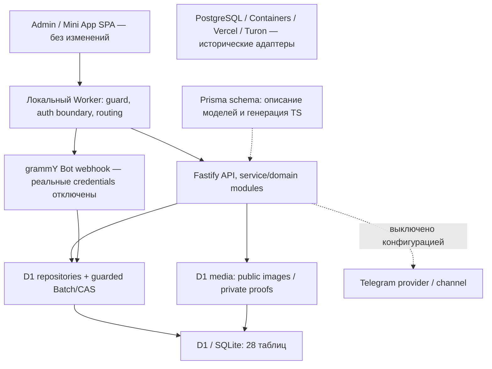

# Б. Полная карта текущего Backend VOYEY

Состояние после этапа 2.1, 22 октября 2026. База изменений: `93ddf43459d7790d4f1e2340b411919c09923f8e`.
Это инвентаризация фактического кода и локальных тестов. Ни один модуль здесь не
объявляется подтверждённым в развёрнутой среде VOYEY: инфраструктура/production
не опрашивались, миграции удалённо не применялись, настоящие платежи/каналы не использовались.
Исторические STENZO deployment reports не являются доказательством текущего VOYEY.

## Архитектура и активность

В активной архитектуре имя PrismaCatalogRepository не означает PostgreSQL:
`packages/database/src/client.ts` экспортирует D1 read facade под именем prisma.
Worker явно внедряет D1 реализации записи. Standalone Node/Next/Turon entrypoints
заблокированы; исторический Prisma schema provider=postgresql нужен для типов,
а его старые SQL-миграции не являются полной схемой активного D1.

В текущем template `COMMERCE_ENABLED=0`, `VOYEY_LOCAL_ONLY=1`, account/D1 IDs —
неактивные нулевые заглушки, origins — reserved `.invalid`, реальные secrets отсутствуют.
Commerce=0 не выключает весь Admin: он блокирует клиентские заказы/оплату и создание
manual order. Catalog/Banners, Auth/Cart и Admin имеют собственные условия готовности.
Local-only отдельно запрещает реальные Telegram/Access credentials и origins.

## Что подтверждено проверками

Build, typecheck, lint, Prisma generate/validate и инфраструктурный preflight прошли.
Основной набор: **985 passed, 5 skipped** (исторические PostgreSQL integration tests).
Распределение: API 189, Worker/D1 451, Admin 150, Mini App 169, Bot 16, config/security 10.
Схема из 17 миграций проверена в отдельной `:memory:` базе; foreign_key_check без ошибок.
Ниже перечислены конкретные тестовые сценарии/файлы; это не утверждение о 100% coverage,
нагрузочной устойчивости или работе с реальными внешними сервисами.

## Инвентаризация модулей

Все HTTP пути в карточках ниже имеют префикс `/api`, кроме явно отмеченных Worker endpoints.
Admin означает отдельный origin + настроенный режим входа + web session, и Origin/CSRF
для изменений. Клиентские owner endpoints требуют JWT и активного User.

### 1. Каталог и категории

**Функции и текущая логика.** CatalogService отдаёт активные неархивные категории и товары, ищет по RU/UZ, фильтрует по категории, использует cursor pagination. Категории плоские: подкатегорий и parentId нет. Названия категорий не зашиты в enum.

**Существующие API.** GET /catalog/categories; GET /catalog/products; GET /catalog/products/:slug; Admin GET/POST/PATCH categories и activate/deactivate/archive/restore.

**Таблицы.** Category, Product, AuditLog.

**Реализовано.** Публичные DTO скрывают sourceUrl и costPrice; архивирование скрывает товар, восстановление оставляет INACTIVE. Архивировать категорию с неархивными товарами нельзя.

**Проверено тестами.** [apps/api/tests/catalog.test.ts](C:/Users/USER/Desktop/Voyey/apps/api/tests/catalog.test.ts), [apps/api/tests/admin-catalog.test.ts](C:/Users/USER/Desktop/Voyey/apps/api/tests/admin-catalog.test.ts), [apps/worker/tests/archive.test.ts](C:/Users/USER/Desktop/Voyey/apps/worker/tests/archive.test.ts). Все перечисленные наборы прошли в локальном прогоне.

**Конфигурация и готовность.** Публичное чтение не требует commerce, но нужна мигрированная D1. Admin требует отдельную настроенную авторизацию; в текущем шаблоне её credentials пусты.

**Не реализовано / границы.** Категории старта не засеяны. Дерево категорий, категории-специфичные атрибуты и полноценная универсальная таксономия отсутствуют.

**Исходники и функции.** [function productWhere](C:/Users/USER/Desktop/Voyey/apps/api/src/modules/catalog/repository.ts:38), [export class CatalogService](C:/Users/USER/Desktop/Voyey/apps/api/src/modules/catalog/service.ts:67), [export class CatalogArchiveService](C:/Users/USER/Desktop/Voyey/apps/api/src/modules/admin/catalog/archive.ts:6).

### 2. Товары, варианты, SKU и цены

**Функции и текущая логика.** Product хранит общие названия, описания, UZS-цену, private себестоимость, временную salePrice, status и category. ProductVariant хранит уникальный SKU, свободные size/color, stock, isActive и теперь preorderEnabled. Изображения принадлежат Product.

**Существующие API.** Admin catalog products/variants CRUD; generate-preview/generate; activate/deactivate; images CRUD/upload; публичные catalog GET.

**Таблицы.** Product, ProductVariant, ProductImage, Category, AuditLog; TelegramProductPost при явной публикации.

**Реализовано.** Проверка положительных целых цен, уникальных slug/SKU, дат акций; безопасная генерация комбинаций размеров/цветов, атомарная запись и обнаружение конфликтов. Генератор не переписывает существующие варианты.

**Проверено тестами.** [apps/worker/tests/variant-generator.test.ts](C:/Users/USER/Desktop/Voyey/apps/worker/tests/variant-generator.test.ts), [apps/worker/tests/variant-generator-api.test.ts](C:/Users/USER/Desktop/Voyey/apps/worker/tests/variant-generator-api.test.ts), [apps/worker/tests/product-cost.test.ts](C:/Users/USER/Desktop/Voyey/apps/worker/tests/product-cost.test.ts), [apps/worker/tests/promotions.test.ts](C:/Users/USER/Desktop/Voyey/apps/worker/tests/promotions.test.ts). Все перечисленные наборы прошли в локальном прогоне.

**Конфигурация и готовность.** Admin CRUD в коде работает независимо от commerce, но текущая конфигурация не готова к реальному Admin login.

**Не реализовано / границы.** Отдельные цены SKU/способов продажи, произвольные характеристики, единицы измерения/упаковки и необязательные size для универсального товара не добавлялись.

**Исходники и функции.** [model Product {](C:/Users/USER/Desktop/Voyey/packages/database/prisma/schema.prisma:135), [model ProductVariant {](C:/Users/USER/Desktop/Voyey/packages/database/prisma/schema.prisma:217), [export class D1VariantGenerator](C:/Users/USER/Desktop/Voyey/apps/api/src/d1/variant-generator.ts:13).

### 3. Наличие и предзаказы — добавлено на этапе 2.1

**Функции и текущая логика.** variantSaleAvailability описывает физически учтённый склад только при конечном stock>0; nullable quantity сохраняется как legacy/untracked. Независимый preorderEnabled позволяет описать PREORDER для того же SKU. PREORDER.checkoutEnabled всегда false.

**Существующие API.** Дополнительное поле preorderEnabled в существующих Admin POST/PATCH variants; availability в обоих публичных Product GET. Нового endpoint checkout-mode нет.

**Таблицы.** ProductVariant.preorderEnabled; AuditLog. Миграция 0017, NOT NULL DEFAULT 0 CHECK IN (0,1). Order/OrderItem не менялись.

**Реализовано.** Поддержаны склад и предзаказ одновременно, только склад, описание предзаказа при stock=0; отсутствие flag остаётся false. stock=null не превращается ни в PREORDER, ни в доказанное физическое наличие.

**Проверено тестами.** [apps/api/tests/catalog.test.ts](C:/Users/USER/Desktop/Voyey/apps/api/tests/catalog.test.ts), [apps/worker/tests/sale-availability.test.ts](C:/Users/USER/Desktop/Voyey/apps/worker/tests/sale-availability.test.ts). Все перечисленные наборы прошли в локальном прогоне.

**Конфигурация и готовность.** Оформление типизированных PREORDER/IN_STOCK не включено даже при commerce=1; явный saleMode отклоняется текущими строгими схемами. В проектной конфигурации также commerce=0.

**Не реализовано / границы.** Выбор режима в корзине/заказе, snapshot режима, резервирование/сроки поставщика и 50%/100% policy. Старые nullable-stock заказы остаются старым flow, а не предзаказами нового типа.

**Исходники и функции.** [export function variantSaleAvailability](C:/Users/USER/Desktop/Voyey/packages/shared/src/sale-availability.ts:17), [export function toProductDto](C:/Users/USER/Desktop/Voyey/apps/api/src/modules/catalog/service.ts:22), [apps/worker/migrations/0017_variant_preorder_enabled.sql](C:/Users/USER/Desktop/Voyey/apps/worker/migrations/0017_variant_preorder_enabled.sql).

### 4. Корзина

**Функции и текущая логика.** Одна корзина на User; позиции уникальны по variantId в корзине. Add/PATCH/DELETE проверяют активность товара/категории/варианта, связь variant-product, количество 1–99 и конечный остаток. Актуальные цены берутся с сервера. Добавление не резервирует склад.

**Существующие API.** GET/DELETE /cart; POST /cart/items; PATCH/DELETE /cart/items/:id; POST /promo-codes/validate.

**Таблицы.** Cart, CartItem, User, Product, ProductVariant, Category; PromoCode/Redemption при проверке скидки.

**Реализовано.** Проверки ownership, остатка, ограничений количества и диапазонов роста/веса; повторная серверная котировка и cart snapshot для промокода. Публичные DTO не раскрывают private costs.

**Проверено тестами.** [apps/api/tests/cart.test.ts](C:/Users/USER/Desktop/Voyey/apps/api/tests/cart.test.ts), [apps/worker/tests/cart-preview.test.ts](C:/Users/USER/Desktop/Voyey/apps/worker/tests/cart-preview.test.ts), [apps/worker/tests/promo-codes.test.ts](C:/Users/USER/Desktop/Voyey/apps/worker/tests/promo-codes.test.ts). Все перечисленные наборы прошли в локальном прогоне.

**Конфигурация и готовность.** Корзина разрешена при commerce=0, но нуждается в корректном JWT/PUBLIC_ORIGIN и User; текущие реальные secrets отсутствуют.

**Не реализовано / границы.** Отдельные строки одного SKU для разных способов продажи, срок жизни резерва, сохранённый выбор предоплаты; гостевая корзина отсутствует.

**Исходники и функции.** [export function assertPurchasable](C:/Users/USER/Desktop/Voyey/apps/api/src/modules/cart/domain.ts:12), [export class D1CartRepository](C:/Users/USER/Desktop/Voyey/apps/api/src/d1/repositories.ts:127).

### 5. Заказы, checkout и история

**Функции и текущая логика.** Checkout перечитывает корзину/цены, проверяет наличие и обязательные рост 100–250 см, вес 30–300 кг, сохраняет неизменяемые снимки товара/SKU/изображения/цен и private cost, создаёт STZ-номер и очищает корзину атомарно. Admin manual order работает без клиентской корзины.

**Существующие API.** POST /checkout; GET /orders и /orders/:publicId; Admin GET /orders и /orders/:publicId; POST /admin/orders/manual/preview и /manual; PATCH status; lifecycle/cancel.

**Таблицы.** Order, OrderItem, Cart/CartItem, User, Product/Variant, AuditLog, PromoCodeRedemption; Payment при чтении оплаты.

**Реализовано.** Idempotency (userId,key), replay исторического заказа без повторного списания stock/промокода, ownership, цена-снимок и разрешённые status transitions. История событий — AuditLog, отдельного OrderEvent нет.

**Проверено тестами.** [apps/api/tests/checkout-orders.test.ts](C:/Users/USER/Desktop/Voyey/apps/api/tests/checkout-orders.test.ts), [apps/worker/tests/checkout-stock.test.ts](C:/Users/USER/Desktop/Voyey/apps/worker/tests/checkout-stock.test.ts), [apps/worker/tests/manual-orders.test.ts](C:/Users/USER/Desktop/Voyey/apps/worker/tests/manual-orders.test.ts), [apps/worker/tests/runtime.test.ts](C:/Users/USER/Desktop/Voyey/apps/worker/tests/runtime.test.ts). Все перечисленные наборы прошли в локальном прогоне.

**Конфигурация и готовность.** COMMERCE_ENABLED=0 блокирует клиентские orders/checkout/payment endpoints и создание manual order. Admin чтение/изменения не выключены этим флагом целиком, но требуют своей авторизации.

**Не реализовано / границы.** Нет typed saleMode, 100% option, expiry/отмены 24ч, split shipment, guest checkout. Рост/вес пока обязательны и для канцелярии/ухода. Повтор того же idempotency key возвращает прежний заказ, не новый заказ с другим payload.

**Исходники и функции.** [export class D1OrderRepository](C:/Users/USER/Desktop/Voyey/apps/api/src/d1/repositories.ts:330), [export function prepareOrderItems](C:/Users/USER/Desktop/Voyey/apps/api/src/modules/checkout/domain.ts:37), [export class ManualOrderService](C:/Users/USER/Desktop/Voyey/apps/api/src/modules/admin/manual-orders.ts:83).

### 6. Склад

**Функции и текущая логика.** Учёт ограничен ProductVariant.stock: целое неотрицательное количество либо null (старый неограниченный/неучитываемый режим). При активном конечном stock checkout проверяет остаток и уменьшает его в том же guarded batch.

**Существующие API.** Admin POST/PATCH variants; generate; складские проверки в Cart/Checkout. Отдельного warehouse CRUD API нет.

**Таблицы.** ProductVariant, OrderItem.inventoryReservedQuantity, AuditLog, _Revision/_BatchGuard.

**Реализовано.** Нет overselling в проверенных конкурентных сценариях; rollback при SQL failure. Изменение preorderEnabled не меняет stock.

**Проверено тестами.** [apps/worker/tests/checkout-stock.test.ts](C:/Users/USER/Desktop/Voyey/apps/worker/tests/checkout-stock.test.ts), [apps/worker/tests/d1.test.ts](C:/Users/USER/Desktop/Voyey/apps/worker/tests/d1.test.ts), [apps/worker/tests/sale-availability.test.ts](C:/Users/USER/Desktop/Voyey/apps/worker/tests/sale-availability.test.ts). Все перечисленные наборы прошли в локальном прогоне.

**Конфигурация и готовность.** Складские записи Admin требуют настроенной авторизации; продажи выключены commerce=0.

**Не реализовано / границы.** Нет складских локаций, партий, приходных накладных, полноценного stock movement ledger или склада поставщика.

**Исходники и функции.** [export async function writeD1Order](C:/Users/USER/Desktop/Voyey/apps/api/src/d1/repositories.ts:238), [export function assertPurchasable](C:/Users/USER/Desktop/Voyey/apps/api/src/modules/cart/domain.ts:12).

### 7. Резервирование и освобождение

**Функции и текущая логика.** Конечный stock уменьшается при создании заказа, до оплаты. Зарезервированное количество сохраняется в OrderItem.inventoryReservedQuantity. При отмене возвращается только подтверждённый конечный резерв; старые неизвестные количества требуют ручной проверки.

**Существующие API.** Checkout/manual order; POST /admin/orders/:publicId/cancel; GET lifecycle; POST stock-reviewed.

**Таблицы.** Order, OrderItem, ProductVariant, PromoCodeRedemption, AuditLog; _Revision/_BatchGuard.

**Реализовано.** CAS/атомарный batch защищает общий остаток; отмена и повтор отмены не возвращают резерв дважды. Снятие promo redemption также атомарно.

**Проверено тестами.** [apps/worker/tests/checkout-stock.test.ts](C:/Users/USER/Desktop/Voyey/apps/worker/tests/checkout-stock.test.ts), [apps/worker/tests/lifecycle.test.ts](C:/Users/USER/Desktop/Voyey/apps/worker/tests/lifecycle.test.ts), [apps/worker/tests/lifecycle-migration.test.ts](C:/Users/USER/Desktop/Voyey/apps/worker/tests/lifecycle-migration.test.ts). Все перечисленные наборы прошли в локальном прогоне.

**Конфигурация и готовность.** Новые клиентские резервы недоступны при commerce=0; admin lifecycle доступен только после настройки Admin.

**Не реализовано / границы.** Нет отдельной Reservation entity/TTL или фонового освобождения. PREORDER не резервирует запас поставщика; такое правило ещё не реализовано.

**Исходники и функции.** [export async function writeD1Order](C:/Users/USER/Desktop/Voyey/apps/api/src/d1/repositories.ts:238), [async cancel(](C:/Users/USER/Desktop/Voyey/apps/api/src/modules/admin/lifecycle.ts:84).

### 8. Оплата и чеки

**Функции и текущая логика.** Суммы выставляет сервер: обязательная предоплата ceil(goodsTotal/2), остаток товара и затем CARGO. Клиент вручную переводит на карту и загружает изображение чека. Проверку достоверности и поступления денег выполняет человек.

**Существующие API.** GET /orders/:publicId/payment-instructions; POST /orders/:publicId/payments (multipart file + Idempotency-Key); Admin list/detail/proof/approve/reject; request-final-payment.

**Таблицы.** Payment, Order, OrderItem, User, MediaObject/MediaChunk, AuditLog; delivery receipt tables для уведомлений.

**Реализовано.** Валидация PNG/JPEG/WebP и размера до 5 MiB, приватное хранение чека, ownership, idempotent submission/review, атомарность payment/order money. APPROVED предоплата ведёт к AWAITING_PURCHASE, final к PAID_FULL; REJECTED возвращает фазу ожидания.

**Проверено тестами.** [apps/api/tests/payment-lifecycle.test.ts](C:/Users/USER/Desktop/Voyey/apps/api/tests/payment-lifecycle.test.ts), [apps/worker/tests/image-proof.test.ts](C:/Users/USER/Desktop/Voyey/apps/worker/tests/image-proof.test.ts), [apps/worker/tests/d1.test.ts](C:/Users/USER/Desktop/Voyey/apps/worker/tests/d1.test.ts), [apps/worker/tests/telegram-payment-review.test.ts](C:/Users/USER/Desktop/Voyey/apps/worker/tests/telegram-payment-review.test.ts). Все перечисленные наборы прошли в локальном прогоне.

**Конфигурация и готовность.** Клиентские платёжные endpoints заблокированы commerce=0; реквизиты и bot secrets пусты. Admin review не является банковским переводом и не включается автоматически после наличия кода.

**Не реализовано / границы.** Нет OCR/автоматической проверки чека, банковского acquiring/reconciliation, payment 100%, произвольной частичной оплаты. Не вызывать это подтверждённым live-платежом VOYEY.

**Исходники и функции.** [export class PaymentService](C:/Users/USER/Desktop/Voyey/apps/api/src/modules/payments/service.ts:75), [private async reviewD1(](C:/Users/USER/Desktop/Voyey/apps/api/src/d1/repositories.ts:463).

### 9. CARGO

**Функции и текущая логика.** После ARRIVED→WEIGHING администратор вводит cargoAmount целиком на заказ. Сервер запрашивает final payment в сумме remainingAmount+cargoAmount; отдельно сохраняется cargoPaidAmount. Нулевой CARGO допустим.

**Существующие API.** POST /admin/orders/:publicId/request-final-payment; payment-instructions; final proof/approval; order DTO.

**Таблицы.** Order.cargoAmount/cargoPaidAmount, Payment(type=FINAL), AuditLog.

**Реализовано.** Проверка статуса WEIGHING, целой суммы, лимита и идемпотентного повтора той же суммы; final approval закрывает остаток товара и CARGO.

**Проверено тестами.** [apps/api/tests/payment-lifecycle.test.ts](C:/Users/USER/Desktop/Voyey/apps/api/tests/payment-lifecycle.test.ts), [apps/worker/tests/runtime.test.ts](C:/Users/USER/Desktop/Voyey/apps/worker/tests/runtime.test.ts), [apps/worker/tests/finance.test.ts](C:/Users/USER/Desktop/Voyey/apps/worker/tests/finance.test.ts). Все перечисленные наборы прошли в локальном прогоне.

**Конфигурация и готовность.** Клиентская оплата отключена; admin-операции требуют своих credentials.

**Не реализовано / границы.** Нет автоматического тарифа по весу, интеграции перевозчика, cargo shipment entity, распределения CARGO между SKU или отдельного калькулятора поставщика. Рост/вес в checkout — данные покупателя, не вес перевозки.

**Исходники и функции.** [override async requestFinalPayment(](C:/Users/USER/Desktop/Voyey/apps/api/src/d1/repositories.ts:572), [public async getInstructions(](C:/Users/USER/Desktop/Voyey/apps/api/src/modules/payments/service.ts:83).

### 10. Отмены и возвраты денег

**Функции и текущая логика.** LifecycleService разрешает отмену только из заданных статусов и при отсутствии SUBMITTED чека. В одной транзакции меняет статус, освобождает подтверждённые резервы/промокод и создаёт Refund на сумму APPROVED платежей. Возврат выполняется вручную и отмечается отдельно.

**Существующие API.** GET /admin/orders/:publicId/lifecycle; POST cancel/stock-reviewed; GET /admin/finance/refunds; POST /admin/finance/refunds/:id/complete.

**Таблицы.** Order, OrderItem, Payment, Refund, ProductVariant, PromoCodeRedemption, AuditLog, CustomerRefundNotificationDelivery.

**Реализовано.** Идемпотентная отмена/complete, запрет завершения возврата для неотменённого заказа, manual reference/note, уведомление только после committed completion.

**Проверено тестами.** [apps/worker/tests/lifecycle.test.ts](C:/Users/USER/Desktop/Voyey/apps/worker/tests/lifecycle.test.ts), [apps/worker/tests/refund-notifications.test.ts](C:/Users/USER/Desktop/Voyey/apps/worker/tests/refund-notifications.test.ts). Все перечисленные наборы прошли в локальном прогоне.

**Конфигурация и готовность.** Реальный перевод денег не выполняется кодом. Admin actions требуют конфигурации, уведомления выключены Telegram-изоляцией.

**Не реализовано / границы.** Нет автоматической отправки денег, частичных refund по позициям, возврата товара с inspection/приёмкой или автосрока отмены.

**Исходники и функции.** [export class LifecycleService](C:/Users/USER/Desktop/Voyey/apps/api/src/modules/admin/lifecycle.ts:56), [async complete(](C:/Users/USER/Desktop/Voyey/apps/api/src/modules/admin/refunds.ts:67), [export const cancellableStatuses](C:/Users/USER/Desktop/Voyey/packages/shared/src/lifecycle.ts:10).

### 11. Пользователи, Telegram auth и клиенты

**Функции и текущая логика.** Telegram initData проверяется HMAC и TTL 600с; User upsert по telegramId, BLOCKED/DELETED не допускаются. JWT HS256 использует issuer voyey-api, audience voyey-miniapp. Locale RU/UZ хранится в User; по умолчанию UZ. CustomerService собирает историю и контакты из заказов.

**Существующие API.** POST /auth/telegram; GET /me; PATCH /me/preferences; Admin GET /customers, /:id, /:id/orders; GET/POST /:id/notes.

**Таблицы.** User, Order, Payment, CustomerNote, AuditLog.

**Реализовано.** JWT/ownership/status checks, точные Telegram IDs, безопасная пагинация/поиск клиентов, append-only заметки с автором и аудитом. Телефон/адрес — snapshot получателя Order, не отдельная адресная книга.

**Проверено тестами.** [apps/api/tests/auth.test.ts](C:/Users/USER/Desktop/Voyey/apps/api/tests/auth.test.ts), [apps/api/tests/telegram-verifier.test.ts](C:/Users/USER/Desktop/Voyey/apps/api/tests/telegram-verifier.test.ts), [apps/worker/tests/preview-auth.test.ts](C:/Users/USER/Desktop/Voyey/apps/worker/tests/preview-auth.test.ts), [apps/worker/tests/customers.test.ts](C:/Users/USER/Desktop/Voyey/apps/worker/tests/customers.test.ts), [apps/worker/tests/customer-notes.test.ts](C:/Users/USER/Desktop/Voyey/apps/worker/tests/customer-notes.test.ts), [apps/worker/tests/language-sync.test.ts](C:/Users/USER/Desktop/Voyey/apps/worker/tests/language-sync.test.ts). Все перечисленные наборы прошли в локальном прогоне.

**Конфигурация и готовность.** Auth и Cart отделены от commerce, но реальные JWT и bot token отсутствуют; current local guard запрещает реальный Telegram token.

**Не реализовано / границы.** Нет Google/Phone Auth, password auth покупателей, гостевых пользователей/адресной книги, полноценного редактирования customer profile или нового account-management API.

**Исходники и функции.** [export class JwtTokenService](C:/Users/USER/Desktop/Voyey/apps/api/src/modules/auth/token.ts:8), [apps/api/src/modules/auth/telegram/verifier.ts](C:/Users/USER/Desktop/Voyey/apps/api/src/modules/auth/telegram/verifier.ts), [export class CustomerService](C:/Users/USER/Desktop/Voyey/apps/api/src/modules/admin/customers.ts:68), [export class CustomerNoteService](C:/Users/USER/Desktop/Voyey/apps/api/src/modules/admin/customer-notes.ts:15).

### 12. Сотрудники, Admin sessions и права

**Функции и текущая логика.** Рабочая граница Worker использует отдельный Admin origin, режим password либо Cloudflare Access, web session cookie и Origin/CSRF. Worker проверяет PBKDF2 proof и создаёт D1 sessions, отбрасывает Bearer и поддельные forwarding headers. TelegramAdmin — отдельные разрешения получателей/операторов бота.

**Существующие API.** Admin auth/method, auth/login, auth/access, auth/session, auth/logout; /admin/health; GET/POST/PATCH /admin/telegram/admins.

**Таблицы.** AdminWebSession, AdminLoginRateLimit, TelegramAdmin, User, AuditLog.

**Реализовано.** HttpOnly/Secure/SameSite=Strict cookie voyey_admin_session, expiry 8ч, revoke, scope checks и rate limits. Есть active/notification flags Telegram-операторов; это не универсальная модель сотрудников.

**Проверено тестами.** [apps/api/tests/web-admin-auth.test.ts](C:/Users/USER/Desktop/Voyey/apps/api/tests/web-admin-auth.test.ts), [apps/worker/tests/admin-direct-password.test.ts](C:/Users/USER/Desktop/Voyey/apps/worker/tests/admin-direct-password.test.ts), [apps/worker/tests/admin-password.test.ts](C:/Users/USER/Desktop/Voyey/apps/worker/tests/admin-password.test.ts), [apps/worker/tests/telegram-admin-api.test.ts](C:/Users/USER/Desktop/Voyey/apps/worker/tests/telegram-admin-api.test.ts), [apps/worker/tests/isolation.test.ts](C:/Users/USER/Desktop/Voyey/apps/worker/tests/isolation.test.ts). Все перечисленные наборы прошли в локальном прогоне.

**Конфигурация и готовность.** В шаблоне password mode, но login/hash/JWT/proxy secrets для runtime не настроены. Старый Access запрещён; новый не создан. Legacy Node Argon2 entrypoint не является текущим Worker login.

**Не реализовано / границы.** Нет Employee entity, персональных Admin-учётных записей, ролей продавец/менеджер/владелец и fine-grained RBAC. Static ADMIN_TELEGRAM_IDS legacy API нельзя считать современными правами web-сотрудников.

**Исходники и функции.** [export function adminPasswordConfiguration](C:/Users/USER/Desktop/Voyey/apps/worker/src/admin-password.ts:18), [async function api(](C:/Users/USER/Desktop/Voyey/apps/worker/src/index.ts:387), [export class WebAdminSessions](C:/Users/USER/Desktop/Voyey/apps/api/src/modules/admin/web-session.ts:17), [export function createAdminGuard](C:/Users/USER/Desktop/Voyey/apps/api/src/modules/admin/authorization.ts:8).

### 13. Telegram Bot и публикации

**Функции и текущая логика.** Bot работает в private chat: /start, магазин и переключение RU/UZ; сохраняет User/locale в D1. Есть /admin и callbacks проверки платежей для активных TelegramAdmin. Publisher создаёт UZ photo post, deep link товара, проверяет bot/channel/menu identity и идемпотентность публикации.

**Существующие API.** POST /telegram/webhook вне /api, секрет в Telegram header; Admin GET /catalog/products/:id/telegram и POST /telegram/publish; настройки /admin/telegram/admins. Команды/ callbacks — Telegram protocol, не HTTP API.

**Таблицы.** User, TelegramAdmin, TelegramProductPost, Payment, Order, AuditLog, delivery tables.

**Реализовано.** Проверки private chat/неботового отправителя, языка, active operator, состояния платежа, актуальной callback-кнопки; публикация только по явному запросу и без слепого retry неопределённой доставки.

**Проверено тестами.** [apps/worker/tests/channel-publishing.test.ts](C:/Users/USER/Desktop/Voyey/apps/worker/tests/channel-publishing.test.ts), [apps/worker/tests/telegram-payment-runtime.test.ts](C:/Users/USER/Desktop/Voyey/apps/worker/tests/telegram-payment-runtime.test.ts), [apps/worker/tests/telegram-payment-review.test.ts](C:/Users/USER/Desktop/Voyey/apps/worker/tests/telegram-payment-review.test.ts), [apps/api/tests/telegram-channel.test.ts](C:/Users/USER/Desktop/Voyey/apps/api/tests/telegram-channel.test.ts). Все перечисленные наборы прошли в локальном прогоне.

**Конфигурация и готовность.** Реального VOYEY bot/channel/webhook нет в конфигурации; local-only guard отклоняет настоящие integration credentials. CLI регистрации и getMe выключены. Bot source сохранён без изменений.

**Не реализовано / границы.** Нет подтверждённого live запуска VOYEY. Настройка нового бота, Main Mini App, канала/меню и проверка прав требуют отдельного этапа; нельзя наследовать STENZO token.

**Исходники и функции.** [export function createStenzoBot](C:/Users/USER/Desktop/Voyey/apps/bot/src/bot.ts:35), [async function webhook(](C:/Users/USER/Desktop/Voyey/apps/worker/src/index.ts:712), [export class TelegramChannelPublisher](C:/Users/USER/Desktop/Voyey/apps/api/src/modules/telegram-channel/publisher.ts:214).

### 14. Финансы, себестоимость и расходы

**Функции и текущая логика.** ProcurementService хранит стоимость единицы в OrderItem snapshot и допускает аудируемую корректировку. ExpenseService ведёт расходы по категории/дате/заказу с void и optimistic version. FinanceService разделяет cash по APPROVED оплатам и прибыль завершённых заказов; расходы/стоимости агрегируются без умножения join.

**Существующие API.** GET /admin/finance; GET/POST /admin/finance/expenses; PATCH /:id; POST /:id/void; GET /admin/orders/:publicId/finance; PATCH /items/:itemId/procurement-cost; refund API.

**Таблицы.** Order, OrderItem, Payment, Expense, Refund, AuditLog.

**Реализовано.** UZS integer money, период Asia/Tashkent, historical costs, суммы CARGO/товаров, расходы и missing cost diagnostics. Неизвестная себестоимость не считается нулевой прибылью: точная прибыль по неполным заказам недоступна.

**Проверено тестами.** [apps/worker/tests/finance.test.ts](C:/Users/USER/Desktop/Voyey/apps/worker/tests/finance.test.ts), [apps/worker/tests/procurement.test.ts](C:/Users/USER/Desktop/Voyey/apps/worker/tests/procurement.test.ts), [apps/worker/tests/expenses.test.ts](C:/Users/USER/Desktop/Voyey/apps/worker/tests/expenses.test.ts), [apps/worker/tests/product-cost.test.ts](C:/Users/USER/Desktop/Voyey/apps/worker/tests/product-cost.test.ts). Все перечисленные наборы прошли в локальном прогоне.

**Конфигурация и готовность.** Admin credentials пусты; real payment flow выключен. Касса/прибыль в тестах основаны только на синтетических данных.

**Не реализовано / границы.** Нет банковской сверки, кассовой/налоговой интеграции, supplier accounts payable, валют/курсов или автоматического финансового экспорта.

**Исходники и функции.** [export class FinanceService](C:/Users/USER/Desktop/Voyey/apps/api/src/modules/admin/finance/analytics.ts:22), [export class ProcurementService](C:/Users/USER/Desktop/Voyey/apps/api/src/modules/admin/finance/procurement.ts:50), [export class ExpenseService](C:/Users/USER/Desktop/Voyey/apps/api/src/modules/admin/finance/expenses.ts:75).

### 15. Доставка и плановое прибытие

**Функции и текущая логика.** Доставка описывается snapshot получателя в Order и ручной цепочкой статусов IN_TRANSIT→ARRIVED, затем READY_TO_SHIP→SHIPPED→COMPLETED. estimatedWarehouseArrival — nullable календарная дата; редактировать можно в AWAITING_PURCHASE/PURCHASED/IN_TRANSIT.

**Существующие API.** GET orders/detail; PATCH /admin/orders/:publicId/status; PATCH /admin/orders/:publicId/warehouse-estimate.

**Таблицы.** Order (получатель, estimatedWarehouseArrival, status, completedAt), OrderItem, AuditLog.

**Реализовано.** Date-only validation без timezone-сдвига, status guards, фиксированный permitted transition, аудит изменения даты и завершения. Дата не является гарантированным SLA.

**Проверено тестами.** [apps/worker/tests/warehouse-estimate.test.ts](C:/Users/USER/Desktop/Voyey/apps/worker/tests/warehouse-estimate.test.ts), [apps/api/tests/payment-lifecycle.test.ts](C:/Users/USER/Desktop/Voyey/apps/api/tests/payment-lifecycle.test.ts), [apps/worker/tests/lifecycle.test.ts](C:/Users/USER/Desktop/Voyey/apps/worker/tests/lifecycle.test.ts). Все перечисленные наборы прошли в локальном прогоне.

**Конфигурация и готовность.** Клиентское чтение заказов выключено commerce=0; Admin требует конфигурации.

**Не реализовано / границы.** Нет carrier API, tracking number/маршрута/тарифа последней мили, этикеток, подтверждения выдачи подписью или автоматического пересчёта ETA.

**Исходники и функции.** [export class WarehouseEstimateService](C:/Users/USER/Desktop/Voyey/apps/api/src/modules/admin/warehouse-estimate.ts:12), [const adminTransitions](C:/Users/USER/Desktop/Voyey/apps/api/src/modules/orders/status-policy.ts:4).

### 16. Уведомления

**Функции и текущая логика.** NotificationService отправляет администраторам новые заказы и фото чеков, клиентам решения по оплате, статусы, final-payment request и completed refund. Язык берётся из preferredLocale. Сначала фиксируется domain transaction, затем внешний send.

**Существующие API.** Отдельного HTTP notification API нет: вызывается checkout/payment/lifecycle/refund handlers; TelegramAdmin настройки управляют получателями.

**Таблицы.** TelegramNotificationDelivery, CustomerTelegramNotificationDelivery, CustomerRefundNotificationDelivery, TelegramAdmin, User; Order/Payment/Refund как события.

**Реализовано.** Durable claims по eventKey+recipient, attemptId, SENT/FAILED/PENDING, ограниченные safe retries. Неопределённая доставка не отправляется повторно вслепую; сбой уведомления не отменяет платёж. Manual order не вызывает new-order admin notification.

**Проверено тестами.** [apps/api/tests/notification-foundation.test.ts](C:/Users/USER/Desktop/Voyey/apps/api/tests/notification-foundation.test.ts), [apps/worker/tests/notification-recovery.test.ts](C:/Users/USER/Desktop/Voyey/apps/worker/tests/notification-recovery.test.ts), [apps/worker/tests/refund-notifications.test.ts](C:/Users/USER/Desktop/Voyey/apps/worker/tests/refund-notifications.test.ts). Все перечисленные наборы прошли в локальном прогоне.

**Конфигурация и готовность.** Без нового bot token уведомления выключены; current local-only запрещает реальные токены.

**Не реализовано / границы.** Нет фонового scheduler/outbox dispatcher, гарантий exactly-once внешнего Telegram send, общей панели ручного разрешения uncertain delivery, email/SMS/push.

**Исходники и функции.** [export class NotificationService](C:/Users/USER/Desktop/Voyey/apps/api/src/modules/notifications/service.ts:39), [export class D1NotificationDeliveryStore](C:/Users/USER/Desktop/Voyey/apps/api/src/d1/notification-deliveries.ts:8), [export class D1CustomerNotificationDeliveryStore](C:/Users/USER/Desktop/Voyey/apps/api/src/d1/customer-notification-deliveries.ts:16).

### 17. Dashboard и аналитика

**Функции и текущая логика.** D1DashboardRepository собирает action queue, клиентские/заказные/товарные и финансовые агрегаты по today/7d/30d/custom, timezone Tashkent, лимит периода 366 дней. Завершённый заказ можно скрыть только на Dashboard; ledger от этого не меняется.

**Существующие API.** GET /admin/dashboard; POST /admin/orders/:publicId/dashboard-visibility; GET /admin/finance.

**Таблицы.** Order, OrderItem, User, Product/Variant, Payment, Expense; AuditLog для hide/restore.

**Реализовано.** Периоды/границы, корректная агрегация и отдельные признаки неполной себестоимости. Dashboard hiding не является удалением/архивом Order.

**Проверено тестами.** [apps/worker/tests/dashboard.test.ts](C:/Users/USER/Desktop/Voyey/apps/worker/tests/dashboard.test.ts), [apps/worker/tests/dashboard-api.test.ts](C:/Users/USER/Desktop/Voyey/apps/worker/tests/dashboard-api.test.ts), [apps/worker/tests/order-dashboard-visibility.test.ts](C:/Users/USER/Desktop/Voyey/apps/worker/tests/order-dashboard-visibility.test.ts). Все перечисленные наборы прошли в локальном прогоне.

**Конфигурация и готовность.** Нужна настроенная Admin session и собственная мигрированная база; реальная аналитика VOYEY не проверялась.

**Не реализовано / границы.** Нет BI событий/воронки посещений, универсальных custom reports или складского прогнозирования.

**Исходники и функции.** [export class D1DashboardRepository](C:/Users/USER/Desktop/Voyey/apps/api/src/d1/dashboard.ts:12), [export class OrderDashboardVisibilityService](C:/Users/USER/Desktop/Voyey/apps/api/src/modules/admin/order-dashboard-visibility.ts:11).

### 18. Маркетинг: баннеры, акции и промокоды

**Функции и текущая логика.** Баннеры RU/UZ ведут в каталог/категорию/товар/безопасный HTTPS URL; archived targets не становятся активными ссылками. Sale price действует по датам. Промокод FIXED/PERCENT нормализуется, проверяет даты/minimum/limits; скидку и расход лимита окончательно считает checkout.

**Существующие API.** GET /home/banners; Admin banners CRUD/activate/deactivate/images/upload; promo-codes CRUD/activate/deactivate; POST /promo-codes/validate.

**Таблицы.** Banner, Product, Category, PromoCode, PromoCodeRedemption, Cart/Order, AuditLog, MediaObject/Chunk.

**Реализовано.** Preview quote не тратит лимит, concurrent redemption атомарен, сумма snapshot сохраняется, cancellation освобождает лимит. Публикация канала описана отдельно.

**Проверено тестами.** [apps/worker/tests/banners.test.ts](C:/Users/USER/Desktop/Voyey/apps/worker/tests/banners.test.ts), [apps/worker/tests/promo-codes.test.ts](C:/Users/USER/Desktop/Voyey/apps/worker/tests/promo-codes.test.ts), [apps/worker/tests/promotions.test.ts](C:/Users/USER/Desktop/Voyey/apps/worker/tests/promotions.test.ts), [apps/worker/tests/archive.test.ts](C:/Users/USER/Desktop/Voyey/apps/worker/tests/archive.test.ts). Все перечисленные наборы прошли в локальном прогоне.

**Конфигурация и готовность.** Публичные баннеры читаются без commerce; quotes требуют User/JWT; использование скидки в новом заказе выключено вместе с checkout. Admin configuration ещё отсутствует.

**Не реализовано / границы.** Нет кампаний/сегментов CRM, отправки рассылок и интеграции рекламной аналитики; typed-mode-specific promo policy пока не определена.

**Исходники и функции.** [export class BannerService](C:/Users/USER/Desktop/Voyey/apps/api/src/modules/marketing/banners.ts:109), [export class PromoCodeService](C:/Users/USER/Desktop/Voyey/apps/api/src/modules/marketing/promo-codes.ts:72), [packages/shared/src/promotions.ts](C:/Users/USER/Desktop/Voyey/packages/shared/src/promotions.ts).

### 19. Медиа и приватное хранение

**Функции и текущая логика.** Изображения и чеки валидируются по фактическому формату/структуре и размеру. В активном Worker используются D1MediaBucket и chunks до 256 KiB, максимум 5 MiB. Public products/ и private payment-proofs/ разделены.

**Существующие API.** GET/HEAD /media/products/:uuid.ext; Admin product/banner upload; POST order proof; GET /admin/payments/:id/proof с авторизацией.

**Таблицы.** MediaObject, MediaChunk, ProductImage, Banner, Payment.

**Реализовано.** Публичный endpoint не выдаёт чеки; безопасные MIME/cache headers, rollback/compensating delete при неуспешной записи метаданных. R2 adapter существует как опциональный, legacy Blob/local providers сохранены.

**Проверено тестами.** [apps/api/tests/image-validation.test.ts](C:/Users/USER/Desktop/Voyey/apps/api/tests/image-validation.test.ts), [apps/api/tests/media-storage.test.ts](C:/Users/USER/Desktop/Voyey/apps/api/tests/media-storage.test.ts), [apps/worker/tests/image-proof.test.ts](C:/Users/USER/Desktop/Voyey/apps/worker/tests/image-proof.test.ts), [apps/api/tests/r2-storage.test.ts](C:/Users/USER/Desktop/Voyey/apps/api/tests/r2-storage.test.ts). Все перечисленные наборы прошли в локальном прогоне.

**Конфигурация и готовность.** R2 bindings/credentials отсутствуют, механизм D1 не менялся. Рабочая медиа-база не переносилась.

**Не реализовано / границы.** Нет R2 activation, видео/PDF/SVG uploads, антивирусной/банковской экспертизы чеков или CDN transformation pipeline.

**Исходники и функции.** [export class D1MediaBucket](C:/Users/USER/Desktop/Voyey/apps/api/src/d1/media.ts:8), [export class PrivateImageStorageService](C:/Users/USER/Desktop/Voyey/apps/api/src/modules/media/service.ts:47), [apps/worker/migrations/0002_media.sql](C:/Users/USER/Desktop/Voyey/apps/worker/migrations/0002_media.sql).

### 20. Аудит, D1 consistency и эксплуатация

**Функции и текущая логика.** D1 repositories выполняют batch writes и AuditLog в одном guarded transaction. Общая _Revision/CAS защищает snapshot, конфликт повторяется до 5 раз. Facade использует только поддержанный поднабор Prisma API. Worker проверяет изоляцию до базы/Access/media.

**Существующие API.** GET /health и /api/health; GET /api/ready. Общего внешнего AuditLog browser API нет.

**Таблицы.** AuditLog, _Revision, _BatchGuard и предметные таблицы; AdminLoginRateLimit для входа.

**Реализовано.** Atomic rollback/конкурентность/unsafe identifiers/parameter limits протестированы. /ready выполняет SELECT 1 и не доказывает применение всех миграций или готовность бизнес-сценариев.

**Проверено тестами.** [apps/worker/tests/d1.test.ts](C:/Users/USER/Desktop/Voyey/apps/worker/tests/d1.test.ts), [apps/worker/tests/isolation.test.ts](C:/Users/USER/Desktop/Voyey/apps/worker/tests/isolation.test.ts), [scripts/voyey-isolation.test.mjs](C:/Users/USER/Desktop/Voyey/scripts/voyey-isolation.test.mjs), [apps/api/tests/deployment.test.ts](C:/Users/USER/Desktop/Voyey/apps/api/tests/deployment.test.ts). Все перечисленные наборы прошли в локальном прогоне.

**Конфигурация и готовность.** Deployment/push/real migrations не выполнялись. Фиксированный local runner запрещает remote/config overrides; нулевые account/D1 IDs и .invalid origins остаются.

**Не реализовано / границы.** Нет удалённой проверки миграций/backup/наблюдаемости VOYEY в этом этапе. Общая revision может ограничивать write throughput; нужны измерения перед ростом, а не преждевременная переработка.

**Исходники и функции.** [export async function atomic](C:/Users/USER/Desktop/Voyey/packages/database/src/d1.ts:374), [export function infrastructureIsolated](C:/Users/USER/Desktop/Voyey/apps/worker/src/isolation.ts:30), [export function checkProject](C:/Users/USER/Desktop/Voyey/scripts/check-preview.mjs:191).

## Полный сценарий существующего заказа и оплаты

1. Telegram initData → User/JWT; клиент выбирает SKU и количество. Cart проверяет
   конечный stock и текущую цену, но не уменьшает склад при Add Cart.
2. Checkout без поля saleMode проверяет получателя, рост/вес, активность и остаток;
   в одном batch сохраняет снимки OrderItem/цены/себестоимость/промокод, уменьшает
   конечный stock и очищает корзину. Начальное состояние AWAITING_PREPAYMENT.
3. Требуемая предоплата — ceil(total/2) целых UZS после применимых скидок.
   Для 100001 UZS это 50001, остаток 50000. Это старый flow, включая конечный stock.
4. Инструкции показывают ручную карту. Клиент загружает приватное изображение;
   сервер сам определяет фазу/ожидаемую сумму, создаёт Payment SUBMITTED и
   PREPAYMENT_SUBMITTED. Загруженный чек сам по себе не подтверждает получение денег.
5. Admin/разрешённый Telegram-оператор APPROVE → AWAITING_PURCHASE; REJECT →
   AWAITING_PREPAYMENT и возможность повторной подачи. Переключение решения после
   завершённого review не допускается; одинаковое решение безопасно повторяется.
6. Ручная цепочка: AWAITING_PURCHASE → PURCHASED → IN_TRANSIT → ARRIVED → WEIGHING.
   Плановая дата склада не перемещает заказ автоматически.
7. Администратор задаёт cargoAmount в WEIGHING → AWAITING_FINAL_PAYMENT.
   Final = остаток товара + CARGO; чек → FINAL_PAYMENT_SUBMITTED;
   APPROVE → PAID_FULL, paidAmount=total, remainingAmount=0,
   cargoPaidAmount=cargoAmount. REJECT возвращает AWAITING_FINAL_PAYMENT.
8. PAID_FULL → READY_TO_SHIP → SHIPPED → COMPLETED; completedAt фиксируется
   при завершении. Платёжные статусы меняются payment policy, а не произвольным PATCH.
9. Отмена возможна только из разрешённого набора и без SUBMITTED чека. Она
   возвращает подтверждённый складской резерв и освобождает промокод один раз.
   При наличии APPROVED денег создаётся PENDING Refund; человек переводит деньги
   и фиксирует COMPLETED с reference/note. Частичного возврата по позициям нет.

Новый preorderEnabled влияет только на каталог и аудит настройки. Он не выбирает
эту цепочку как PREORDER и не меняет ни одного расчёта выше. Явная передача saleMode
PREORDER/IN_STOCK в старые checkout/cart/manual schemas даёт 400 в тестах.
Все live client commerce endpoints сейчас дополнительно закрыты конфигурацией.

## База данных: фактическая D1-схема

В отдельной SQLite :memory: последовательно применены 0001–0017. Ниже 28 таблиц
из исходных SQL, включая внутренние CAS/media таблицы; сервисная history-таблица
самого Wrangler здесь не создавалась. Все 16 прежних миграций сохранены без изменений.
Их применение в удалённой среде не проверялось и не предполагается.

| Группа               | Таблицы                                                                                                | Основные связи и ограничения                                                                                              |
| -------------------- | ------------------------------------------------------------------------------------------------------ | ------------------------------------------------------------------------------------------------------------------------- |
| Пользователь         | User                                                                                                   | telegramId UNIQUE, status/locale CHECK; связи с Cart/Order/Notes/Audit                                                    |
| Каталог              | Category, Product                                                                                      | slug UNIQUE; Product.categoryId FK; soft archive сохраняет историю                                                        |
| Варианты             | ProductVariant                                                                                         | productId FK, sku UNIQUE; stock NULL или >=0; новое preorderEnabled NOT NULL DEFAULT 0 CHECK(0,1)                         |
| Изображения          | ProductImage                                                                                           | productId FK, storageKey UNIQUE; partial UNIQUE primary image на продукт                                                  |
| Корзина              | Cart, CartItem                                                                                         | Cart.userId UNIQUE FK; CartItem(cartId,variantId) UNIQUE, quantity и measurements constraints                             |
| Заказ                | Order, OrderItem                                                                                       | Order(userId,idempotencyKey) UNIQUE; OrderItem FK в Order/Product/Variant; денежные snapshots и inventoryReservedQuantity |
| Платёж               | Payment                                                                                                | orderId/reviewedByUserId FK; (orderId,idempotencyKey) UNIQUE; type/status/money constraints                               |
| Admin                | AdminWebSession, AdminLoginRateLimit                                                                   | tokenHash/key PK, expiry и persistent limits; новый cookie namespace не требует изменения таблицы                         |
| Telegram             | TelegramAdmin, TelegramProductPost                                                                     | telegramId UNIQUE; post(productId,channelChatId) UNIQUE, productId FK                                                     |
| Доставка уведомлений | TelegramNotificationDelivery, CustomerTelegramNotificationDelivery, CustomerRefundNotificationDelivery | уникальность eventKey+telegramId, attempt/status; отдельные получатели, не foreign-key связь с живым чатом                |
| Маркетинг            | Banner, PromoCode, PromoCodeRedemption                                                                 | Banner targets FK SET NULL; PromoCode.code UNIQUE; Redemption.orderId UNIQUE, FK promo/user/order; release marker         |
| Финансы/клиенты      | Expense, Refund, CustomerNote                                                                          | Expense.orderId FK optional; Refund.orderId UNIQUE FK; Note.userId FK; положительные суммы/allowed statuses               |
| Медиа                | MediaObject, MediaChunk                                                                                | chunk(objectKey,ordinal) PK; FK CASCADE в object; private/key namespace, MIME, размер и chunk bounds                      |
| Аудит/конкурентность | AuditLog, _Revision, _BatchGuard                                                                       | Audit actor optional FK; revision singleton; guard CHECK обеспечивает atomic snapshot validation                          |

Связи проверены `PRAGMA foreign_key_check`: 0 ошибок. Prisma schema не содержит
все D1-only media/customer delivery/CAS механизмы; SQL-миграции и D1 adapter являются
источником фактической активной схемы. В частности, не следует запускать старые
Prisma migrate/seed для обновления D1 или переписывать 0001 через исторический generator.

## Критичные зависимости следующего этапа

- Выбранный mode должен попасть в CartItem и неизменяемый OrderItem snapshot;
  нельзя выводить исторический способ продажи из текущего stock/флага каталога.
- Для конечного склада сохранить атомарное резервирование и idempotency, для
  PREORDER отдельно определить поставщика/лимит/сроки и отсутствие ложного списания stock.
- Согласовать смысл legacy stock=null. Сейчас старое поведение сохранено; ни
  физическое наличие, ни новый предзаказ автоматически из него не выводятся.
- Согласовать policy 50%/100%, смешанных корзин, CARGO и final payment. Сейчас
  финансы и payment review рассчитаны на одну фиксированную предоплату 50%.
- Сделать измерения условными для категорий, прежде чем обещать checkout канцелярии
  и средств ухода. Это зависимость следующего этапа, не выполненное изменение.
- Сотрудникам нужны отдельные идентичности и модель прав; Telegram notification
  flags и общий web login не являются готовым RBAC.
- Нагрузку общей D1 revision, Free limits и объём D1 media нужно измерять на
  тестовой VOYEY инфраструктуре. Результаты unit/integration tests этого не доказывают.
- Уведомления и ручные платежи надо проверять с собственными resources по отдельному
  разрешению. Автоматизация банков, перенос клиентов или STENZO credentials не требуется.

## Полная карта явных HTTP-маршрутов

Пути уже включают внешний `/api`. Таблица отражает зарегистрированные методы,
не добавляет автоматически создаваемые Fastify HEAD/OPTIONS и не означает, что
endpoint доступен с неактивными шаблонами credentials. Все Admin mutations требуют
Origin/CSRF; webhook — Telegram secret. Загружаемые файлы используют multipart `file`.
Ошибки payload обычно 400, auth/session 401/403, отсутствующие сущности 404,
конфликты/stock/state 409, upload limits 413/415, неготовая конфигурация 503.

| HTTP      | Endpoint                                                           | Доступ / назначение                                    | Исходник                                                                                                                    |
| --------- | ------------------------------------------------------------------ | ------------------------------------------------------ | --------------------------------------------------------------------------------------------------------------------------- |
| POST      | `/api/admin/catalog/products/:id/archive`                          | Admin / каталог                                        | [route.ts:123](C:/Users/USER/Desktop/Voyey/apps/api/src/modules/admin/catalog/route.ts:123)                                 |
| POST      | `/api/admin/catalog/products/:id/restore`                          | Admin / каталог                                        | [route.ts:123](C:/Users/USER/Desktop/Voyey/apps/api/src/modules/admin/catalog/route.ts:123)                                 |
| POST      | `/api/admin/catalog/categories/:id/archive`                        | Admin / каталог                                        | [route.ts:123](C:/Users/USER/Desktop/Voyey/apps/api/src/modules/admin/catalog/route.ts:123)                                 |
| POST      | `/api/admin/catalog/categories/:id/restore`                        | Admin / каталог                                        | [route.ts:123](C:/Users/USER/Desktop/Voyey/apps/api/src/modules/admin/catalog/route.ts:123)                                 |
| GET       | `/api/admin/catalog/upload-config`                                 | Admin / каталог                                        | [route.ts:152](C:/Users/USER/Desktop/Voyey/apps/api/src/modules/admin/catalog/route.ts:152)                                 |
| GET       | `/api/admin/catalog/products/:id/telegram`                         | Admin / каталог                                        | [route.ts:156](C:/Users/USER/Desktop/Voyey/apps/api/src/modules/admin/catalog/route.ts:156)                                 |
| POST      | `/api/admin/catalog/products/:id/telegram/publish`                 | Admin / каталог                                        | [route.ts:172](C:/Users/USER/Desktop/Voyey/apps/api/src/modules/admin/catalog/route.ts:172)                                 |
| POST      | `/api/admin/catalog/products/:productId/images/upload`             | Admin / каталог                                        | [route.ts:196](C:/Users/USER/Desktop/Voyey/apps/api/src/modules/admin/catalog/route.ts:196)                                 |
| GET       | `/api/admin/catalog/categories`                                    | Admin / каталог                                        | [route.ts:252](C:/Users/USER/Desktop/Voyey/apps/api/src/modules/admin/catalog/route.ts:252)                                 |
| POST      | `/api/admin/catalog/categories`                                    | Admin / каталог                                        | [route.ts:256](C:/Users/USER/Desktop/Voyey/apps/api/src/modules/admin/catalog/route.ts:256)                                 |
| PATCH     | `/api/admin/catalog/categories/:id`                                | Admin / каталог                                        | [route.ts:272](C:/Users/USER/Desktop/Voyey/apps/api/src/modules/admin/catalog/route.ts:272)                                 |
| POST      | `/api/admin/catalog/categories/:id/activate`                       | Admin / каталог                                        | [route.ts:298](C:/Users/USER/Desktop/Voyey/apps/api/src/modules/admin/catalog/route.ts:298)                                 |
| POST      | `/api/admin/catalog/categories/:id/deactivate`                     | Admin / каталог                                        | [route.ts:298](C:/Users/USER/Desktop/Voyey/apps/api/src/modules/admin/catalog/route.ts:298)                                 |
| GET       | `/api/admin/catalog/products`                                      | Admin / каталог                                        | [route.ts:316](C:/Users/USER/Desktop/Voyey/apps/api/src/modules/admin/catalog/route.ts:316)                                 |
| GET       | `/api/admin/catalog/products/:id`                                  | Admin / каталог                                        | [route.ts:325](C:/Users/USER/Desktop/Voyey/apps/api/src/modules/admin/catalog/route.ts:325)                                 |
| POST      | `/api/admin/catalog/products`                                      | Admin / каталог                                        | [route.ts:338](C:/Users/USER/Desktop/Voyey/apps/api/src/modules/admin/catalog/route.ts:338)                                 |
| PATCH     | `/api/admin/catalog/products/:id`                                  | Admin / каталог                                        | [route.ts:355](C:/Users/USER/Desktop/Voyey/apps/api/src/modules/admin/catalog/route.ts:355)                                 |
| POST      | `/api/admin/catalog/products/:id/activate`                         | Admin / каталог                                        | [route.ts:382](C:/Users/USER/Desktop/Voyey/apps/api/src/modules/admin/catalog/route.ts:382)                                 |
| POST      | `/api/admin/catalog/products/:id/deactivate`                       | Admin / каталог                                        | [route.ts:382](C:/Users/USER/Desktop/Voyey/apps/api/src/modules/admin/catalog/route.ts:382)                                 |
| POST      | `/api/admin/catalog/products/:productId/images`                    | Admin / каталог                                        | [route.ts:410](C:/Users/USER/Desktop/Voyey/apps/api/src/modules/admin/catalog/route.ts:410)                                 |
| PATCH     | `/api/admin/catalog/images/:id`                                    | Admin / каталог                                        | [route.ts:431](C:/Users/USER/Desktop/Voyey/apps/api/src/modules/admin/catalog/route.ts:431)                                 |
| DELETE    | `/api/admin/catalog/images/:id`                                    | Admin / каталог                                        | [route.ts:449](C:/Users/USER/Desktop/Voyey/apps/api/src/modules/admin/catalog/route.ts:449)                                 |
| POST      | `/api/admin/catalog/products/:productId/variants`                  | Admin / каталог                                        | [route.ts:462](C:/Users/USER/Desktop/Voyey/apps/api/src/modules/admin/catalog/route.ts:462)                                 |
| PATCH     | `/api/admin/catalog/variants/:id`                                  | Admin / каталог                                        | [route.ts:483](C:/Users/USER/Desktop/Voyey/apps/api/src/modules/admin/catalog/route.ts:483)                                 |
| POST      | `/api/admin/catalog/products/:productId/variants/generate-preview` | Admin / каталог                                        | [route.ts:506](C:/Users/USER/Desktop/Voyey/apps/api/src/modules/admin/catalog/route.ts:506)                                 |
| POST      | `/api/admin/catalog/products/:productId/variants/generate`         | Admin / каталог                                        | [route.ts:506](C:/Users/USER/Desktop/Voyey/apps/api/src/modules/admin/catalog/route.ts:506)                                 |
| POST      | `/api/admin/catalog/variants/:id/activate`                         | Admin / каталог                                        | [route.ts:536](C:/Users/USER/Desktop/Voyey/apps/api/src/modules/admin/catalog/route.ts:536)                                 |
| POST      | `/api/admin/catalog/variants/:id/deactivate`                       | Admin / каталог                                        | [route.ts:536](C:/Users/USER/Desktop/Voyey/apps/api/src/modules/admin/catalog/route.ts:536)                                 |
| GET       | `/api/admin/customers/:id/notes`                                   | Admin / клиенты/заметки                                | [customer-notes.ts:100](C:/Users/USER/Desktop/Voyey/apps/api/src/modules/admin/customer-notes.ts:100)                       |
| POST      | `/api/admin/customers/:id/notes`                                   | Admin / клиенты/заметки                                | [customer-notes.ts:115](C:/Users/USER/Desktop/Voyey/apps/api/src/modules/admin/customer-notes.ts:115)                       |
| GET       | `/api/admin/customers`                                             | Admin / клиенты/заметки                                | [customers.ts:225](C:/Users/USER/Desktop/Voyey/apps/api/src/modules/admin/customers.ts:225)                                 |
| GET       | `/api/admin/customers/:id`                                         | Admin / клиенты/заметки                                | [customers.ts:230](C:/Users/USER/Desktop/Voyey/apps/api/src/modules/admin/customers.ts:230)                                 |
| GET       | `/api/admin/customers/:id/orders`                                  | Admin / заказ/доставка                                 | [customers.ts:235](C:/Users/USER/Desktop/Voyey/apps/api/src/modules/admin/customers.ts:235)                                 |
| GET       | `/api/admin/dashboard`                                             | Admin / Dashboard                                      | [dashboard.ts:86](C:/Users/USER/Desktop/Voyey/apps/api/src/modules/admin/dashboard.ts:86)                                   |
| GET       | `/api/admin/finance`                                               | Admin / финансы/возврат                                | [analytics.ts:207](C:/Users/USER/Desktop/Voyey/apps/api/src/modules/admin/finance/analytics.ts:207)                         |
| GET       | `/api/admin/finance/expenses`                                      | Admin / финансы/возврат                                | [expenses.ts:243](C:/Users/USER/Desktop/Voyey/apps/api/src/modules/admin/finance/expenses.ts:243)                           |
| POST      | `/api/admin/finance/expenses`                                      | Admin / финансы/возврат                                | [expenses.ts:246](C:/Users/USER/Desktop/Voyey/apps/api/src/modules/admin/finance/expenses.ts:246)                           |
| PATCH     | `/api/admin/finance/expenses/:id`                                  | Admin / финансы/возврат                                | [expenses.ts:249](C:/Users/USER/Desktop/Voyey/apps/api/src/modules/admin/finance/expenses.ts:249)                           |
| POST      | `/api/admin/finance/expenses/:id/void`                             | Admin / финансы/возврат                                | [expenses.ts:254](C:/Users/USER/Desktop/Voyey/apps/api/src/modules/admin/finance/expenses.ts:254)                           |
| GET       | `/api/admin/orders/:publicId/finance`                              | Admin / финансы/возврат                                | [procurement.ts:169](C:/Users/USER/Desktop/Voyey/apps/api/src/modules/admin/finance/procurement.ts:169)                     |
| PATCH     | `/api/admin/orders/:publicId/items/:itemId/procurement-cost`       | Admin / финансы/возврат                                | [procurement.ts:174](C:/Users/USER/Desktop/Voyey/apps/api/src/modules/admin/finance/procurement.ts:174)                     |
| GET       | `/api/admin/orders/:publicId/lifecycle`                            | Admin / заказ/доставка                                 | [lifecycle.ts:238](C:/Users/USER/Desktop/Voyey/apps/api/src/modules/admin/lifecycle.ts:238)                                 |
| POST      | `/api/admin/orders/:publicId/cancel`                               | Admin / заказ/доставка                                 | [lifecycle.ts:243](C:/Users/USER/Desktop/Voyey/apps/api/src/modules/admin/lifecycle.ts:243)                                 |
| POST      | `/api/admin/orders/:publicId/stock-reviewed`                       | Admin / заказ/доставка                                 | [lifecycle.ts:248](C:/Users/USER/Desktop/Voyey/apps/api/src/modules/admin/lifecycle.ts:248)                                 |
| POST      | `/api/admin/orders/manual/preview`                                 | Admin / заказ/доставка                                 | [manual-orders.ts:173](C:/Users/USER/Desktop/Voyey/apps/api/src/modules/admin/manual-orders.ts:173)                         |
| POST      | `/api/admin/orders/manual`                                         | Admin / заказ/доставка                                 | [manual-orders.ts:180](C:/Users/USER/Desktop/Voyey/apps/api/src/modules/admin/manual-orders.ts:180)                         |
| POST      | `/api/admin/orders/:publicId/dashboard-visibility`                 | Admin / заказ/доставка                                 | [order-dashboard-visibility.ts:43](C:/Users/USER/Desktop/Voyey/apps/api/src/modules/admin/order-dashboard-visibility.ts:43) |
| GET       | `/api/admin/finance/refunds`                                       | Admin / финансы/возврат                                | [refunds.ts:117](C:/Users/USER/Desktop/Voyey/apps/api/src/modules/admin/refunds.ts:117)                                     |
| POST      | `/api/admin/finance/refunds/:id/complete`                          | Admin / финансы/возврат                                | [refunds.ts:120](C:/Users/USER/Desktop/Voyey/apps/api/src/modules/admin/refunds.ts:120)                                     |
| GET       | `/api/admin/health`                                                | Admin / health/readiness                               | [route.ts:13](C:/Users/USER/Desktop/Voyey/apps/api/src/modules/admin/route.ts:13)                                           |
| GET       | `/api/admin/telegram/admins`                                       | Admin / Telegram-операторы                             | [telegram.ts:63](C:/Users/USER/Desktop/Voyey/apps/api/src/modules/admin/telegram.ts:63)                                     |
| POST      | `/api/admin/telegram/admins`                                       | Admin / Telegram-операторы                             | [telegram.ts:66](C:/Users/USER/Desktop/Voyey/apps/api/src/modules/admin/telegram.ts:66)                                     |
| PATCH     | `/api/admin/telegram/admins/:id`                                   | Admin / Telegram-операторы                             | [telegram.ts:73](C:/Users/USER/Desktop/Voyey/apps/api/src/modules/admin/telegram.ts:73)                                     |
| PATCH     | `/api/admin/orders/:publicId/warehouse-estimate`                   | Admin / заказ/доставка                                 | [warehouse-estimate.ts:46](C:/Users/USER/Desktop/Voyey/apps/api/src/modules/admin/warehouse-estimate.ts:46)                 |
| POST      | `/api/admin/auth/login`                                            | Admin boundary / вход или session                      | [web-auth.ts:31](C:/Users/USER/Desktop/Voyey/apps/api/src/modules/admin/web-auth.ts:31)                                     |
| GET       | `/api/admin/auth/session`                                          | Admin boundary / вход или session                      | [web-auth.ts:58](C:/Users/USER/Desktop/Voyey/apps/api/src/modules/admin/web-auth.ts:58)                                     |
| POST      | `/api/admin/auth/logout`                                           | Admin boundary / вход или session                      | [web-auth.ts:63](C:/Users/USER/Desktop/Voyey/apps/api/src/modules/admin/web-auth.ts:63)                                     |
| POST      | `/api/auth/telegram`                                               | initData HMAC / вход                                   | [route.ts:29](C:/Users/USER/Desktop/Voyey/apps/api/src/modules/auth/route.ts:29)                                            |
| GET       | `/api/me`                                                          | User JWT + ownership / профиль/язык                    | [route.ts:46](C:/Users/USER/Desktop/Voyey/apps/api/src/modules/auth/route.ts:46)                                            |
| PATCH     | `/api/me/preferences`                                              | User JWT + ownership / профиль/язык                    | [route.ts:52](C:/Users/USER/Desktop/Voyey/apps/api/src/modules/auth/route.ts:52)                                            |
| GET       | `/api/cart`                                                        | User JWT + ownership / корзина                         | [route.ts:66](C:/Users/USER/Desktop/Voyey/apps/api/src/modules/cart/route.ts:66)                                            |
| POST      | `/api/cart/items`                                                  | User JWT + ownership / корзина                         | [route.ts:70](C:/Users/USER/Desktop/Voyey/apps/api/src/modules/cart/route.ts:70)                                            |
| PATCH     | `/api/cart/items/:id`                                              | User JWT + ownership / корзина                         | [route.ts:82](C:/Users/USER/Desktop/Voyey/apps/api/src/modules/cart/route.ts:82)                                            |
| DELETE    | `/api/cart/items/:id`                                              | User JWT + ownership / корзина                         | [route.ts:100](C:/Users/USER/Desktop/Voyey/apps/api/src/modules/cart/route.ts:100)                                          |
| DELETE    | `/api/cart`                                                        | User JWT + ownership / корзина                         | [route.ts:111](C:/Users/USER/Desktop/Voyey/apps/api/src/modules/cart/route.ts:111)                                          |
| GET       | `/api/catalog/categories`                                          | Публичный / каталог                                    | [route.ts:18](C:/Users/USER/Desktop/Voyey/apps/api/src/modules/catalog/route.ts:18)                                         |
| GET       | `/api/catalog/products`                                            | Публичный / каталог                                    | [route.ts:22](C:/Users/USER/Desktop/Voyey/apps/api/src/modules/catalog/route.ts:22)                                         |
| GET       | `/api/catalog/products/:slug`                                      | Публичный / каталог                                    | [route.ts:35](C:/Users/USER/Desktop/Voyey/apps/api/src/modules/catalog/route.ts:35)                                         |
| POST      | `/api/checkout`                                                    | User JWT + ownership / заказ/доставка                  | [route.ts:37](C:/Users/USER/Desktop/Voyey/apps/api/src/modules/checkout/route.ts:37)                                        |
| GET       | `/api/health`                                                      | Публичный / health/readiness                           | [route.ts:9](C:/Users/USER/Desktop/Voyey/apps/api/src/modules/health/route.ts:9)                                            |
| GET       | `/api/ready`                                                       | Публичный / health/readiness                           | [route.ts:14](C:/Users/USER/Desktop/Voyey/apps/api/src/modules/health/route.ts:14)                                          |
| POST      | `/api/promo-codes/validate`                                        | User JWT + ownership / маркетинг                       | [promo-routes.ts:11](C:/Users/USER/Desktop/Voyey/apps/api/src/modules/marketing/promo-routes.ts:11)                         |
| GET       | `/api/admin/marketing/promo-codes`                                 | Admin / маркетинг                                      | [promo-routes.ts:31](C:/Users/USER/Desktop/Voyey/apps/api/src/modules/marketing/promo-routes.ts:31)                         |
| POST      | `/api/admin/marketing/promo-codes`                                 | Admin / маркетинг                                      | [promo-routes.ts:34](C:/Users/USER/Desktop/Voyey/apps/api/src/modules/marketing/promo-routes.ts:34)                         |
| PATCH     | `/api/admin/marketing/promo-codes/:id`                             | Admin / маркетинг                                      | [promo-routes.ts:42](C:/Users/USER/Desktop/Voyey/apps/api/src/modules/marketing/promo-routes.ts:42)                         |
| POST      | `/api/admin/marketing/promo-codes/:id/activate`                    | Admin / маркетинг                                      | [promo-routes.ts:53](C:/Users/USER/Desktop/Voyey/apps/api/src/modules/marketing/promo-routes.ts:53)                         |
| POST      | `/api/admin/marketing/promo-codes/:id/deactivate`                  | Admin / маркетинг                                      | [promo-routes.ts:53](C:/Users/USER/Desktop/Voyey/apps/api/src/modules/marketing/promo-routes.ts:53)                         |
| GET       | `/api/home/banners`                                                | Публичный / маркетинг                                  | [routes.ts:14](C:/Users/USER/Desktop/Voyey/apps/api/src/modules/marketing/routes.ts:14)                                     |
| GET       | `/api/admin/marketing/banners`                                     | Admin / маркетинг                                      | [routes.ts:26](C:/Users/USER/Desktop/Voyey/apps/api/src/modules/marketing/routes.ts:26)                                     |
| POST      | `/api/admin/marketing/banners`                                     | Admin / маркетинг                                      | [routes.ts:29](C:/Users/USER/Desktop/Voyey/apps/api/src/modules/marketing/routes.ts:29)                                     |
| PATCH     | `/api/admin/marketing/banners/:id`                                 | Admin / маркетинг                                      | [routes.ts:32](C:/Users/USER/Desktop/Voyey/apps/api/src/modules/marketing/routes.ts:32)                                     |
| DELETE    | `/api/admin/marketing/banners/:id`                                 | Admin / маркетинг                                      | [routes.ts:39](C:/Users/USER/Desktop/Voyey/apps/api/src/modules/marketing/routes.ts:39)                                     |
| POST      | `/api/admin/marketing/banners/:id/activate`                        | Admin / маркетинг                                      | [routes.ts:48](C:/Users/USER/Desktop/Voyey/apps/api/src/modules/marketing/routes.ts:48)                                     |
| POST      | `/api/admin/marketing/banners/:id/deactivate`                      | Admin / маркетинг                                      | [routes.ts:48](C:/Users/USER/Desktop/Voyey/apps/api/src/modules/marketing/routes.ts:48)                                     |
| POST      | `/api/admin/marketing/banners/:id/images/upload`                   | Admin / маркетинг                                      | [routes.ts:59](C:/Users/USER/Desktop/Voyey/apps/api/src/modules/marketing/routes.ts:59)                                     |
| GET       | `/api/orders`                                                      | User JWT + ownership / заказ/доставка                  | [route.ts:50](C:/Users/USER/Desktop/Voyey/apps/api/src/modules/orders/route.ts:50)                                          |
| GET       | `/api/orders/:publicId`                                            | User JWT + ownership / заказ/доставка                  | [route.ts:58](C:/Users/USER/Desktop/Voyey/apps/api/src/modules/orders/route.ts:58)                                          |
| GET       | `/api/admin/orders`                                                | Admin / заказ/доставка                                 | [route.ts:68](C:/Users/USER/Desktop/Voyey/apps/api/src/modules/orders/route.ts:68)                                          |
| GET       | `/api/admin/orders/:publicId`                                      | Admin / заказ/доставка                                 | [route.ts:74](C:/Users/USER/Desktop/Voyey/apps/api/src/modules/orders/route.ts:74)                                          |
| GET       | `/api/orders/:publicId/payment-instructions`                       | User JWT + ownership / чек/платёж                      | [route.ts:120](C:/Users/USER/Desktop/Voyey/apps/api/src/modules/payments/route.ts:120)                                      |
| POST      | `/api/orders/:publicId/payments`                                   | User JWT + ownership / чек/платёж                      | [route.ts:138](C:/Users/USER/Desktop/Voyey/apps/api/src/modules/payments/route.ts:138)                                      |
| GET       | `/api/admin/payments`                                              | Admin / чек/платёж                                     | [route.ts:196](C:/Users/USER/Desktop/Voyey/apps/api/src/modules/payments/route.ts:196)                                      |
| GET       | `/api/admin/payments/:id`                                          | Admin / чек/платёж                                     | [route.ts:202](C:/Users/USER/Desktop/Voyey/apps/api/src/modules/payments/route.ts:202)                                      |
| GET       | `/api/admin/payments/:id/proof`                                    | Admin / чек/платёж                                     | [route.ts:216](C:/Users/USER/Desktop/Voyey/apps/api/src/modules/payments/route.ts:216)                                      |
| POST      | `/api/admin/payments/:id/approve`                                  | Admin / чек/платёж                                     | [route.ts:232](C:/Users/USER/Desktop/Voyey/apps/api/src/modules/payments/route.ts:232)                                      |
| POST      | `/api/admin/payments/:id/reject`                                   | Admin / чек/платёж                                     | [route.ts:246](C:/Users/USER/Desktop/Voyey/apps/api/src/modules/payments/route.ts:246)                                      |
| PATCH     | `/api/admin/orders/:publicId/status`                               | Admin / заказ/доставка                                 | [route.ts:266](C:/Users/USER/Desktop/Voyey/apps/api/src/modules/payments/route.ts:266)                                      |
| POST      | `/api/admin/orders/:publicId/request-final-payment`                | Admin / заказ/доставка                                 | [route.ts:287](C:/Users/USER/Desktop/Voyey/apps/api/src/modules/payments/route.ts:287)                                      |
| GET       | `/api/admin/auth/method`                                           | Admin boundary / PBKDF2 challenge                      | [Worker:524](C:/Users/USER/Desktop/Voyey/apps/worker/src/index.ts:524)                                                      |
| POST      | `/api/admin/auth/access`                                           | Admin boundary / Access session либо password required | [Worker:540](C:/Users/USER/Desktop/Voyey/apps/worker/src/index.ts:540)                                                      |
| GET       | `/health`                                                          | Публичный Worker health без проверки DB schema         | [Worker:791](C:/Users/USER/Desktop/Voyey/apps/worker/src/index.ts:791)                                                      |
| GET, HEAD | `/media/products/:uuid.:ext`                                       | Публичное изображение, не private proof                | [Worker:692](C:/Users/USER/Desktop/Voyey/apps/worker/src/index.ts:692)                                                      |
| POST      | `/telegram/webhook`                                                | Telegram secret + отдельный bot; выключен шаблоном     | [Worker:712](C:/Users/USER/Desktop/Voyey/apps/worker/src/index.ts:712)                                                      |

Всего описано 98 явных Fastify method/path пар и 5 внешних/перехваченных Worker строк. Admin login/session/logout на Worker проходят boundary, даже если соответствующий legacy Fastify handler также присутствует в исходниках.

## Итоговая таблица для планирования

Следующие шаги ниже — аналитические зависимости, а не разрешение их реализовывать.

| Модуль             | Уже есть                                            | Добавлено                                          | Не хватает                              | Следующий шаг                                 |
| ------------------ | --------------------------------------------------- | -------------------------------------------------- | --------------------------------------- | --------------------------------------------- |
| Каталог            | Активные категории/товары, поиск, cursor, архив     | Availability в вариантах DTO                       | Категории-специфичные атрибуты          | Согласовать модель универсального товара      |
| Товары/варианты    | SKU, size/color, цены/акции, изображения, генератор | preorderEnabled в SKU CRUD и аудите                | Цены по mode/SKU при необходимости      | Подтвердить ценовую policy                    |
| Наличие/предзаказы | Stock finite/null legacy                            | Оба признака одновременно, PREORDER checkout=false | Typed order flow                        | Отдельный этап выбора способа продажи         |
| Корзина            | Ownership, stock/qty checks, promo quote            | Отклонение typed mode подтверждено тестами         | Mode в строке корзины                   | Согласовать mixed cart и idempotency          |
| Заказы             | Snapshot, 50%, manual/client, история/статусы       | Старый flow сохранён и проверен                    | Sale mode snapshot, 100%, таймер        | Спроектировать policy без потери истории      |
| Склад              | Остаток на SKU, атомарное списание                  | Независимость от preorder flag                     | Партии/локации/ledger                   | Уточнить потребности магазина                 |
| Резервирование     | Резерв при заказе, возврат при отмене               | Проверено отсутствие обхода stock                  | TTL и supplier reservation              | Согласовать отдельные правила                 |
| Платежи/чеки       | Ручная карта, private proof, Admin review           | Расчёты сохранены                                  | Выбор 50/100%, reconciliation           | Отдельный платёжный этап                      |
| CARGO              | Ручная сумма в WEIGHING, final total                | Без изменений                                      | Тариф/вес/перевозчик                    | Уточнить источник суммы                       |
| Отмена/возврат     | Guarded cancel, full refund record/complete         | Без изменений                                      | Partial returns/автовозврат             | Определить бизнес-процесс отдельно            |
| Пользователи       | Telegram HMAC/JWT, RU/UZ, customer history/notes    | Без изменений                                      | Google/Phone/адресная книга             | Не расширять auth без задания                 |
| Сотрудники/права   | Web session, scope/CSRF, TelegramAdmin flags        | Без изменений                                      | Персональные роли/RBAC                  | Согласовать роли и персональные входы         |
| Telegram           | Bot, язык, callback review, photo publication       | Новые продажи не активированы                      | Новый live bot/channel/webhook          | Собственные ресурсы по разрешению             |
| Финансы            | Cash/profit, cost snapshots, expenses/refunds       | Без изменений                                      | Новые payment-mode allocations          | Обновлять вместе с payment policy             |
| Доставка           | Ручные статусы, получатель, warehouse date          | Без изменений                                      | Carrier tracking/SLA                    | Уточнить процесс выдачи/доставки              |
| Уведомления        | Durable claims/dedupe, RU/UZ, safe retries          | Без изменений                                      | Фоновый dispatcher/uncertain resolution | Отдельно определить retry workflow            |
| Dashboard          | Периоды/очереди/агрегаты, hide completed            | Без изменений                                      | BI/воронка/нагрузочные измерения        | Проверить на своей тестовой среде             |
| Маркетинг          | Баннеры, акции, промокоды с лимитами                | Без изменений                                      | Policy для разных sale modes            | Согласовать после typed checkout              |
| Медиа              | D1 public/private chunks, validation                | Без изменений                                      | R2 только при необходимости             | Сохранить механизм до отдельного решения      |
| Инфраструктура/БД  | Локальная изоляция и 16 прежних миграций            | 0017, синхронные Prisma/D1 types                   | Собственная мигрированная среда         | Применение только после отдельного разрешения |
