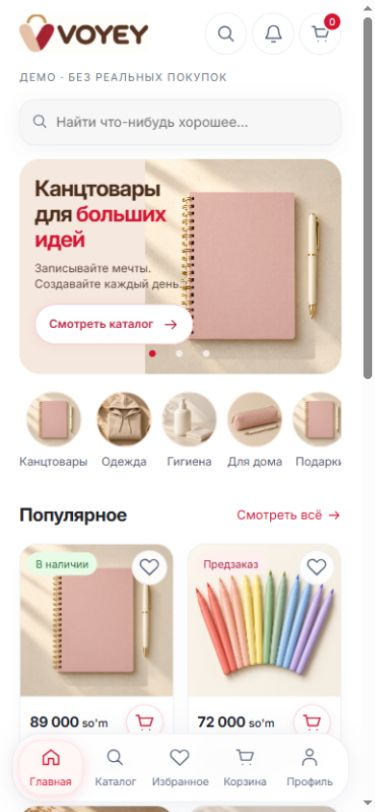
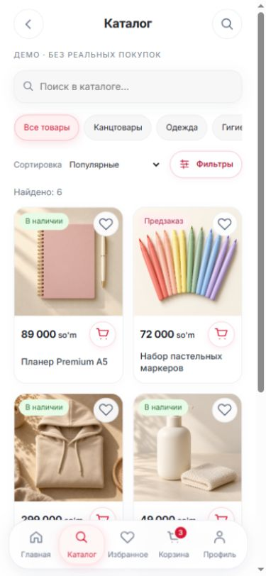
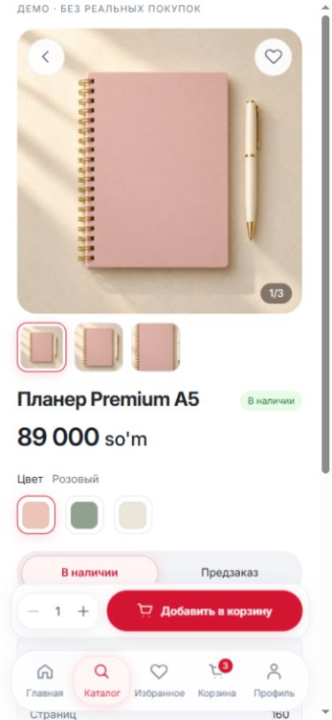
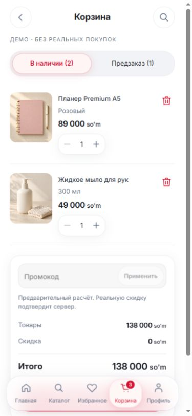
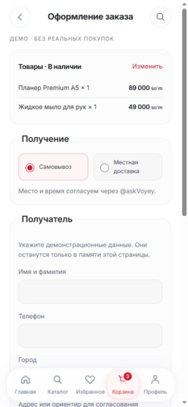

# VOYEY — Frontend UI-01

Дата: 24.10.2026. Рабочая копия: `C:/Users/USER/Desktop/Voyey`.
Ветка: `chore/voyey-bootstrap`.
Исходный HEAD: `cc2c8b2640137ab1252b4a0ef1fc178d35afece8`.
Коммит реализации, тестов и визуальных материалов: **`c8c30abbc28b415026e3d31f2e8a3363c5a4e00b`**.

Реализован настоящий React/TypeScript интерфейс на локальных демонстрационных данных. Он доступен через отдельный Vite dev-вход и не подключён к production Mini App. Backend, Worker, Admin, Bot, зависимости, схемы, инфраструктура и все прежние исходные файлы сохранены.

## Запуск и границы демонстрации

Из корня проекта, с Node 24.x и закреплённым pnpm 10.17.1:

```powershell
pnpm --filter @stenzo/miniapp dev --port 5173 --strictPort
```

Открыть <http://127.0.0.1:5173/voyey-demo.html>. Именно этот HTML запускает новый UI; обычный `/` продолжает открывать прежний Mini App. Сервер слушает `127.0.0.1`. Во время проверки он был реально запущен локально.

`entry.tsx` разрешает импорт приложения только при `import.meta.env.DEV` и loopback hostname. `voyey-demo.html` не добавлен во входы production build. Проверено содержимое `apps/miniapp/dist`: только существующие `index.html`, JS/CSS и Inter; новых экранов, mock-кодов, demo storage key и товарных PNG там нет. Worker получает прежние статические production assets.

Новый UI не импортирует API client, session/cart providers или Telegram SDK. Он использует только чистые существующие `Locale`, `localizedText`, SPA navigation hooks и shared availability/types. CSP ограничивает ресурсы своим origin, запрещает отправку HTML-форм и внешние соединения; loopback WebSocket разрешён для Vite HMR. CSP дополняет отсутствие сетевых writers и исключение из production, а не заменяет их.

Все покупки, остатки, промокоды и платежи — локальная модель. Заказы, данные получателя, имена файлов, избранное и корзина живут только в памяти страницы. Перезагрузка сбрасывает их. В localStorage записывается только `voyey.ui01.locale`; реальные auth/session ключи не читаются. Локальные маршруты имеют форму `voyey-demo.html?screen=cart&mode=PREORDER`, без персональных данных в URL.

`COMMERCE_ENABLED=0` сохранён. Реальных заказов, чеков, финансовых записей, миграций, Telegram запросов и deployment не выполнялось. Push/merge не выполнялись.

## А. Экраны и действия

| Экран               | Реализация                                                                                                                                                                                                                        |
| ------------------- | --------------------------------------------------------------------------------------------------------------------------------------------------------------------------------------------------------------------------------- |
| Главная             | Оригинальный логотип, поиск, уведомления, счётчик корзины; три переключаемых баннера; пять категорий; отдельные секции популярного и новинок; переходы, избранное и добавление товара                                             |
| Каталог             | Поиск по RU/UZ названиям, категории, сортировка популярность/новизна/цена, модальные фильтры режима/цены/размера; две колонки на телефоне, три на планшете, четыре на desktop; пустой результат                                   |
| Товар               | Большая фотография, миниатюры и счётчик; выбранный вариант, существующие размер/цвет только у подходящих товаров; динамические характеристики, описание и условия получения; доступные режимы; количество, избранное и добавление |
| Корзина             | Независимые вкладки IN_STOCK/PREORDER с количеством; фото, название, вариант, цена, изменение количества, удаление; отдельные promo input/ошибка/скидка/итоги; пустая корзина и пустая вкладка                                    |
| Checkout            | Только строки выбранного режима; данные получателя; самовывоз/местное такси; ручная оплата на карту без реквизитов; IN_STOCK 100%, PREORDER 50/100%; условия demo; переход к mock FIRST                                           |
| Первая оплата       | Сумма FIRST, 24 часа и countdown, выбор локального изображения или тестовой мета-записи файла, pending/approved/rejected, максимум три accepted submit, истечение и одно дополнительное окно 2 часа                               |
| Избранное и профиль | Работающий список избранного; переключение языка, локальный список demo-заказов, контактное пояснение, сброс демонстрации                                                                                                         |

Все основные кнопки имеют действие. Уведомления и контакт открывают информационные диалоги, не отправляют сообщения. Не выдуманы отзывы, рейтинги, реальные реквизиты или стоимость доставки.

## Б. Компоненты и токены

`apps/miniapp/src/voyey/components.tsx` содержит `VoyeyButton`, `VoyeyIconButton`, `VoyeyBottomNav`, `VoyeySearchBar`, `VoyeyProductCard`, `VoyeyCategoryChip`, `VoyeySaleModeBadge`, `VoyeyQuantityControl`, `VoyeyGlassSurface`, `VoyeyPrice`, `VoyeyProductGallery`, `VoyeyVariantSelector`, `VoyeyPromoInput`, `VoyeyEmptyState`, `VoyeyCheckoutSummary`. Дополнительно: `VoyeyLogo`, `VoyeyIcon`, `VoyeyModeToggle`, `VoyeyDialog`.

В `styles.css` выделены CSS tokens цветов, отступов, размеров текста, радиусов, теней, свечения, blur и высоты controls. Основные значения: белый фон; `#B71C3C`, `#D31532`, `#4A2C1A`, `#FFF1F1`, `#F7F7F8`; радиусы 16/20/24 px, blur 16 px, основной control 48 px. Стекло ограничено поиском, навигацией и плавающими controls. CSS-градиентов нет.

Есть selected/pressed/disabled/loading states, focus-visible, native labels, aria-pressed/current/status, native modal dialog с Escape, уменьшение анимации через prefers-reduced-motion. Inter загружается из уже существующего локального font asset. Переводы находятся в `messages.ts`, включая временные уведомления, цены и ошибки; названия/описания/характеристики fixtures имеют RU/UZ значения. Проверено совпадение ключей словарей.

Safe area учитывает `env(safe-area-inset-*)` и Telegram CSS variables; высота — Telegram stable viewport или `100dvh`. Нижняя покупка и навигация имеют разные отступы; конец контента имеет запас прокрутки. При уменьшении visualViewport из-за клавиатуры плавающие панели скрываются. Это подготовка адаптивного поведения; реальный Telegram WebView и физическая экранная клавиатура на телефоне на этом этапе не проверялись.

## В. Соответствие референсу

Сохранены белая основа, тёплые фотографии, коричневый логотип, красные CTA, розовые selected states, мягкое стекло, скруглённые фото и нижний бар из пяти пунктов. Главная после визуальной проверки уплотнена: баннер около 220–224 px на телефоне, цены первой товарной строки видны раньше. Не перенесены стили STENZO.

Это адаптация композиции, а не побайтовая копия референса: фотографии другие, домашние товарные секции двухколоночные для читаемости, текст формы длиннее из-за корректных правил получения и demo-пояснений. Градиенты из исходной концепции заменены однотонными заливками и тенями. Рейтинги удалены как неподтверждённые данные. Реквизиты и произвольные «другие способы оплаты» не добавлены.

Основной пользовательский логотип и отдельный символ скопированы без изменения байтов. Белые поля оригиналов ограничиваются CSS viewport, сами PNG не обрезаны, не перерисованы и не перекрашены. SHA-256 и источники: `docs/ui-01/assets-manifest.json`.

## Г. Корзина, checkout, скидки и FIRST

`domain.ts` — исключительно модель демонстрации, не реализация новых серверных endpoints.

- Ключ строки: SKU + saleMode. Два режима одного SKU существуют независимо. Сумма количества по обоим режимам не больше 99.
- IN_STOCK использует конечный положительный остаток. PREORDER доступен только при `preorderEnabled=true`, включая stock=0; при оформлении не уменьшает склад. `stock=null` не преобразуется в PREORDER. Прежний UI и его legacy-семантика сохранены полностью; новые fixtures используют конечный stock.
- Цвет и размер не обязательны для всех товаров. Одежда в fixtures требует мерок покупателя при добавлении; канцтовары и гигиена — нет. Это не вес товара для CARGO.
- Проверки цены, количества, разрешения SKU и мерок выполняются до формирования нового state. При ошибке исходный state не изменяется. Повторное оформление уже очищенной вкладки не создаёт второй demo-заказ.
- Checkout удаляет только выбранную вкладку и её promo; другая вкладка сохраняет строки и применённый код. IN_STOCK уменьшает только свой mock finite stock. Локальный заказ хранит копии названия, варианта, цены, количества и характеристик на момент оформления.
- Promo-коды демонстрационные: `READY10` — IN_STOCK 10%; `PRE15` — PREORDER 15%; `VOYEY99` — 99%; `HELLO50000` — FIXED 50 000. Один код на оформление, без переноса между вкладками. Изменение строки/количества снимает её предварительную скидку.
- PERCENT допускает 1–99; FIXED ограничен `floor(99% * subtotal)`. Положительная скидка невозможна на слишком маленькой сумме; бесплатный заказ не создаётся. Величины целые, потолок считается через BigInt. CARGO не входит в базу скидки.
- Начальные mock суммы: IN_STOCK 138 000; после READY10 — 124 200, первая оплата 100%. PREORDER 72 000; после PRE15 — 61 200, при 50% первый платёж 30 600 и такой же остаток. Нечётная половина округляется вверх.
- Для PREORDER 100% сумма FIRST равна стоимости товаров после скидки; неизвестный CARGO остаётся отдельным будущим начислением. Местное такси оплачивает покупатель отдельно, цена не придумана; согласование — через @askVoyey.
- Receipt input принимает PNG/JPEG/WebP до 5 МБ и декодирует изображение перед показом локального blob preview. Никакой upload не производится. «Тестовый файл» создаёт только мета-запись; банковского документа нет.
- Принятый submit переводит mock claim в SUBMITTED и расходует одну из трёх попыток. Pending блокирует следующий submit, сохраняется после истечения таймера до решения. Replay того же key не расходует попытку. Invalid file не расходует её.
- Mock review после своевременного submit может подтвердить платёж после deadline. Первый поздний REJECT выдаёт 2 часа ровно один раз; повторный REJECT не продлевает срок, четвёртая попытка запрещена. В simulator можно пропустить 24 часа, завершить окно и выбрать решение.

Таймер клиента не считается разрешением на настоящий платёж. UI явно объясняет, что будущий серверный `firstPaymentWindow` и серверные guards остаются источником истины. Demo не реализует банковский ledger, квоты реальных промокодов, production stock reservations, отмены, возвраты или автоматический release по времени. Серверная бизнес-логика B2 не менялась.

## Д. Mock и изображения

Каталог — шесть синтетических товаров, пять категорий, временные SKU, цены, остатки, характеристики и начальные строки корзины из `fixtures.ts`. Имена получателей для браузерной проверки были вымышленными; в исходниках/отчёте/скриншотах checkout нет клиентских данных.

Пять временных фотографий сгенерированы встроенным imagegen в режиме generation с непрозрачным фоном. Файлы сохранены без последующей обработки:

| Файл в `apps/miniapp/src/voyey/assets/` | Назначение                                                                |
| --------------------------------------- | ------------------------------------------------------------------------- |
| `notebook.png`                          | Планер, категория канцтоваров, временное изображение подарочного блокнота |
| `markers.png`                           | Набор маркеров                                                            |
| `hoodie.png`                            | Худи                                                                      |
| `care.png`                              | Жидкое мыло и категория гигиены                                           |
| `pouch.png`                             | Органайзер и категория для дома                                           |
| `voyey-original.png`                    | Неизменённый пользовательский основной логотип                            |
| `voyey-symbol-original.png`             | Неизменённый пользовательский символ                                      |

Точные prompts, mode, SHA-256 и сохранённые пути перечислены в `docs/ui-01/assets-manifest.json`. Нужно заменить только временные товарные фото после получения настоящих. Нынешняя галерея показывает три CSS-ракурса одного demo-изображения, а не три реальные фотографии; смена цвета не перекрашивает оригинал и не выдаёт фото за настоящий снимок другого SKU. PNG намеренно остаются исходными и достаточно тяжёлыми; оптимизацию и реальные галереи стоит сделать отдельно перед production. Они сейчас исключены из production assets.

## Е. Будущая интеграция API

| Область                 | Что потребуется после отдельного разрешения                                                                                                                                                      |
| ----------------------- | ------------------------------------------------------------------------------------------------------------------------------------------------------------------------------------------------ |
| Каталог                 | Подключить существующий API client и DTO чтения каталога; согласовать exposure `preorderEnabled`, атрибутов, SKU availability, category policy и настоящих галерей                               |
| Корзина                 | Получать авторизованный серверный snapshot и применять подтверждённые mutations по saleMode; цены/остатки/99 проверяет сервер, а не только браузер                                               |
| Promo                   | Подключить серверный preview выбранной вкладки; не передавать клиентскую сумму скидки; обработать eligibility, scope, квоты, reservation и stale quote                                           |
| Checkout                | Отдельно согласовать публичный HTTP adapter для default-off `SaleModeCheckoutCommit`, idempotency/recovery и раздельные оформления; не направлять новые режимы в старый `/checkout`              |
| FIRST                   | Считать `firstPaymentWindow` из серверного state, обработать server clock/deadline/attempts/pending/replay; подключить приватный proof upload только после готовности соответствующего контракта |
| Профиль/заказы          | Вернуть Telegram session/auth providers только в согласованной интеграции; загрузить реального пользователя, историю и серверные суммы/статусы                                                   |
| CARGO/остаточная оплата | Читать подтверждённое поступление и фактическое начисление отдельно от FIRST и местного такси                                                                                                    |

Новые selected checkout и promo v2 пока внутренние/default-off согласно отчётам B1/B2. Новых публичных маршрутов UI-01 не создаёт. Owner review в demo не вызывает настоящие административные endpoints.

## Ж. Файлы

Ни один из прежних 678 tracked файлов не изменён и не удалён. Добавлены:

- `apps/miniapp/voyey-demo.html` — отдельный local-only dev-вход и CSP.
- `apps/miniapp/src/voyey/entry.tsx` — DEV/loopback guard.
- `apps/miniapp/src/voyey/App.tsx` — экраны, локальное состояние, маршруты, checkout/payment simulation.
- `apps/miniapp/src/voyey/components.tsx` — переиспользуемые controls.
- `apps/miniapp/src/voyey/domain.ts` — чистые mock policies и переходы состояния.
- `apps/miniapp/src/voyey/fixtures.ts` — типизированные данные, совместимые расширения старых каталоговых типов.
- `apps/miniapp/src/voyey/messages.ts` — RU/UZ словари и прежний localization helper.
- `apps/miniapp/src/voyey/assets.ts`, `env.d.ts` — Vite asset URLs и типы, без правок общей конфигурации.
- `apps/miniapp/src/voyey/styles.css` — собственная тема, tokens, адаптивность, states и safe areas.
- Семь PNG из таблицы выше.
- `apps/miniapp/tests/voyey-ui.test.mjs` — 11 новых сценариев.
- `docs/ui-01/assets-manifest.json`, `verification.json`, `screenshots/*.jpg`, `screenshots/responsive-ru.json`, `screenshots/responsive-uz.json` — происхождение ресурсов и проверочные материалы.
- Этот отчёт.

`index.html`, `spa.tsx`, старые компоненты, `vite.config.ts`, lockfile, package manifests, схемы D1/Prisma и все 28 миграций остались прежними. Новые зависимости не устанавливались: использованы уже доступные версии проекта.

## З. Проверки и фактическое наблюдение

| Проверка                                    | Результат                                                                                                      |
| ------------------------------------------- | -------------------------------------------------------------------------------------------------------------- |
| Корневой build                              | PASS; Worker только защищённый локальный dry-run                                                               |
| Корневой typecheck / lint                   | PASS                                                                                                           |
| Prisma generate / validate                  | PASS; только генерация локального клиента и валидация, без миграций реальных БД                                |
| Полный набор                                | **1467 passed, 5 PostgreSQL skipped, 0 failed**                                                                |
| Mini App                                    | **180 passed**, в том числе 11 новых UI domain/isolation сценариев                                             |
| Финальные Mini App typecheck / lint / tests | PASS                                                                                                           |
| Prettier / git diff check                   | PASS                                                                                                           |
| git fsck --full                             | PASS, повреждённых объектов не найдено                                                                         |
| Gitleaks, новый UI и весь рабочий проект    | Утечек не найдено                                                                                              |
| Сохранность                                 | Все 678 исходных файлов совпадают по SHA-256 после допустимой нормализации CRLF/LF; пропущенных/изменённых нет |
| Production isolation                        | Новые entry/components/mock markers/PNG отсутствуют в production Mini App assets                               |
| Оригинальные логотипы                       | Побайтовые SHA-256 совпали с пользовательскими файлами                                                         |

Первый полный запуск тестов выполнялся локально с очищенными credentials/proxy env и выключенными PostgreSQL integrations. Повторные общие прогоны частично использовали локальный Turbo cache; после финальных изменений повторены проверки Mini App, чистые UI tests и визуальные измерения затронутой главной. Существующие тесты не удалялись. Логи находятся в `.cache/voyey-ui-01/` и не входят в Git. Сводка сохранена в `docs/ui-01/verification.json`.

Корневой build выдаёт прежние нефатальные Vite предупреждения об игнорируемых `use client` и sourcemap старых Mini App/Admin компонентов; exit code 0. Эти старые файлы не исправлялись в UI-01.

Браузерная проверка действительно проведена в Chromium in-app browser на localhost. Все пять основных экранов измерены на RU/UZ при ширинах **320, 375, 390, 430, 768, 1280** и высоте 844 CSS px. В 60 уникальных сочетаниях `scrollWidth == clientWidth`; сломанных загруженных изображений нет; buy bar и nav не пересекаются. У браузера классический scrollbar 15 px, поэтому ширина доступного содержимого, например при viewport 390, равна 375 px. Горизонтальные категории прокручиваются внутри своей полосы и не растягивают документ.

В браузере пройдены поиск, сортировка, фильтры цены/режима, галерея, вариант, избранное, PREORDER add, количество, remove, обе пустые корзинные ситуации, invalid/success promo и его снятие при изменении количества. Пройдены IN_STOCK 100% и PREORDER 50% checkout с вымышленными данными, pending submit, поздний REJECT/2h и mock approve. RU/UZ переключение проверено, включая уведомление при смене языка. Ограничение 99, stock=0/preorderEnabled, отсутствие неявного PREORDER при null, откат ошибок и максимум три submit дополнительно покрыты автоматическими тестами.

В ходе проверки исправлены: сочетание размера и режима фильтров по разным SKU; растягивание radio input общим правилом ширины и возникавший горизонтальный scroll; старый язык временного уведомления; плотность баннера и обрезание первой подписи категории. Это изменения только нового UI.

### Скриншоты

Сохранены реальные viewport screenshots, а не перерисованный макет. Full-page capture в используемом браузере не удалось получить; показаны верхние viewport и дополнительные состояния. Для нижней кнопки checkout отдельно измерена доступность после прокрутки: её нижняя граница около 726 px, верх nav 762 px при высоте 844. Скриншоты разных сценариев не являются одним непрерывным заказом.

| Главная                                | Каталог                                   | Товар                                     | Корзина                                | Checkout                                   |
| -------------------------------------- | ----------------------------------------- | ----------------------------------------- | -------------------------------------- | ------------------------------------------ |
|  |  |  |  |  |

Дополнительные материалы: `06-payment-390.jpg`, `catalog-320.jpg`, `home-uz-320.jpg`, `product-uz-320.jpg`, `checkout-desktop-1280.jpg`. Машинные измерения RU/UZ лежат рядом. Физический iOS/Android Telegram WebView, soft keyboard, notch и accessibility screen reader требуют отдельного device QA; desktop responsive emulation не подтверждает их работу в развёрнутой среде.

## И. Git

Коммит реализации: `c8c30abbc28b415026e3d31f2e8a3363c5a4e00b`. Он добавляет 32 файла, без изменений прежних исходников. Этот отчёт фиксируется отдельным локальным коммитом поверх реализации; его итоговый HEAD и чистота дерева проверяются после записи отчёта и сообщаются владельцу. Полный перечень можно получить `git show --stat c8c30ab`.

Никаких удалённых операций записи нет. Снимок STENZO, исходные STENZO каталоги и production не изменялись.

## К. План UI-02 — только после подтверждения

1. Согласовать визуальные замечания владельца по пяти экранам; заменить временные изображения настоящими, подготовить реальные variant galleries и оптимизированные размеры с сохранением оригинального логотипа.
2. Провести device QA в Telegram iOS/Android: safe areas, клавиатура, scroll/focus, font scaling, screen reader, слабая сеть и загрузка изображений. Развить loading/error/retry для реальных источников данных.
3. Сначала подключить чтение каталога через прежний client/DTO, сохранив UI presenter/components; определить boundary между demo adapter и авторизованным серверным состоянием.
4. Отдельным Backend/API этапом согласовать публикацию default-off selected checkout/promo/FIRST contracts. До этого не включать commerce и не использовать legacy checkout для новых режимов.
5. Подключить серверную корзину, preview и idempotent selected checkout; обработать цены/stock/conflicts, uncertain retry и восстановление после reload. Денежные суммы и permissions брать с сервера.
6. Подключить приватные чеки, `firstPaymentWindow` и server-side ограничения; оставить owner review в Admin. Удалить simulator из реального customer flow.
7. Развить профиль и историю заказов, отдельные FIRST/остаток/CARGO, уведомления и поддержку RU/UZ на настоящих данных.

UI-01 завершён как локальная демонстрационная реализация. Переход к UI-02, подключение writers и инфраструктуры требует следующего разрешения владельца.
